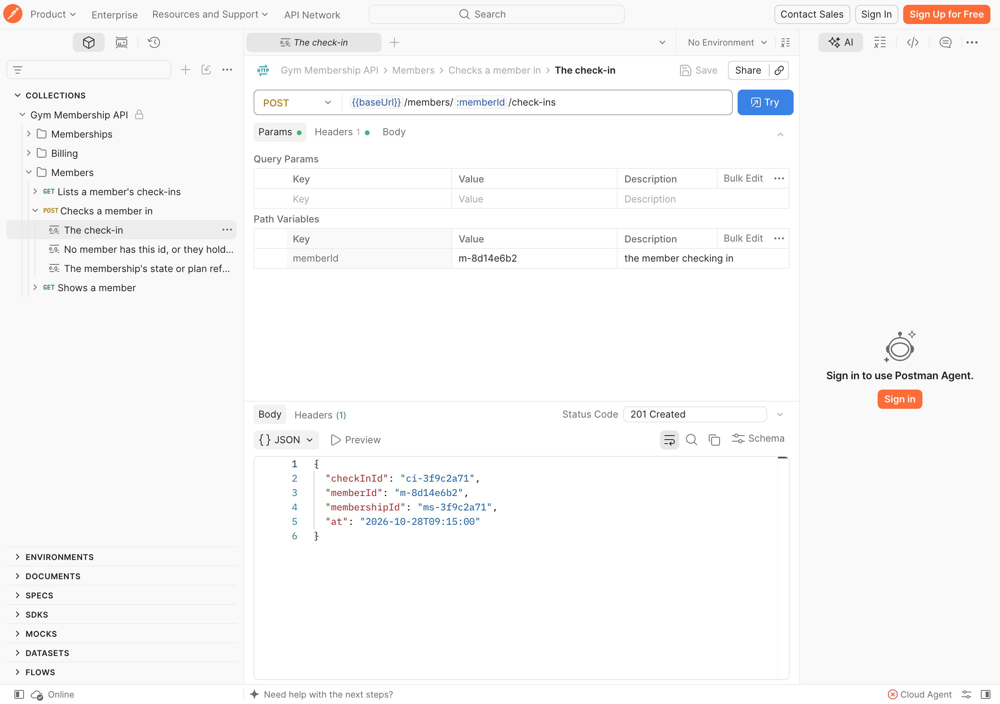
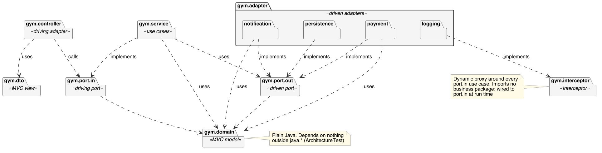

# Gym & Fitness Club Membership System

CS6451 Advanced Software Design, Team-Based Assignment Part 1 (Brightspace Group 1), University of Limerick, Autumn 2026/27.

A monolithic (package-by-layer MVC + Hexagonal, with Interceptor) business tier for a gym and fitness club: membership plans and billing, class bookings with capacity and waitlists, check-in, freezes, penalties, and referral credits. The front end is simulated with Postman and the data layer with file I/O behind repositories and DTOs.

**Deadline: 23:59 Sun 1 Nov 2026.**

**The report:** the [latest draft PDF](https://github.com/CS6451-Advanced-Software-Design/Gym-Membership/releases/download/report-latest/report.pdf) is rebuilt from [report/sections](report/sections) on every merge to `main`. Each release has the report as it stood at that version.

**Try it, no setup needed:** the app is live at https://gym-membership-production-a725.up.railway.app, which opens its Swagger UI. The public [Postman workspace](https://www.postman.com/spaceflight-geoscientist-47956182/workspace/gym-membership) has every endpoint, documented from the code, and sends to the live app by default. Pick the **mock** environment for Postman's saved examples, or **local** for the app on your machine. See [code/README.md](code/README.md#postman).

## Team

| Member | GitHub | Roles |
| --- | --- | --- |
| Chirag Aggarwal | @ChiragAgg5k | Architect, Designer. Owns Billing |
| Bharat Doodi | @AKABharat | Project Manager, Tester. Owns Booking |
| DineshReddy Mogili | @sanjuD1603 | Documentation Manager, Technical Lead + DevOps. Owns Member |
| Dhruv Punj | @DHRUVx22 | Business Analyst, Systems Analyst. Owns Membership |

See [report/roles.md](report/roles.md) for the full role split.

## Repository layout

| Folder | What lives there |
| --- | --- |
| [report/](report) | Everything for the report: write-ups, diagrams, diary, GenAI log, plans |
| [code/](code) | Everything that builds and runs: the Spring Boot project, the OpenAPI spec and Postman collections, JSON data |

## Documents

| Doc | Purpose |
| --- | --- |
| [report/requirements](report/requirements/README.md) | Actors, use cases, business rules, quality attributes (report §4) |
| [report/architecture](report/architecture/README.md) | MVC + Hexagonal + Interceptor, package diagram, hosting stack (report §5) |
| [report/analysis](report/analysis/README.md) | Candidate objects, class, sequence, state chart and ER diagrams (report §6) |
| [report/sketches](report/sketches/README.md) | Photos of our rough work and hand-drawn sketches (report §6). **Add photos as you draw** |
| [report/tech-stack.md](report/tech-stack.md) | Java 21 + Spring Boot, Maven, tests, CI/CD, metrics, UML workbench, hosting stack (report §5, §8, §9, §10) |
| [report/sample-project-lessons.md](report/sample-project-lessons.md) | What past submissions did well and where they lost marks |
| [report/sections](report/sections) | **The report itself**: one Markdown file per section, in the spec's order. Write your sections here, in your own words. Each file starts with a comment saying what it needs and who owns it |
| [report/pdf](report/pdf) | Builds the PDF: front cover, the blank marking scheme, contents and page numbers. Run `report/pdf/build.sh` (needs pandoc and Typst), or download it from the **Report** check on any PR. Student IDs for the cover go in `report/pdf/report.yaml` |
| [report/report-plan.md](report/report-plan.md) | Owner, evidence and quality bar for every report section (§1–14) |
| [report/roles.md](report/roles.md) | Roles and package ownership (report §3) |
| [report/diary.md](report/diary.md) | Weekly diary, Weeks 4–12 (report §7). **Update every week** |
| [report/genai-prompts.md](report/genai-prompts.md) | Every GenAI prompt used (report §13). **Log prompts as you go** |

## Patterns

Each pattern is listed with its roles (as named in the lectures, GoF or POSA2) and the class that plays each one. Every class links to its file. Only patterns the code really has are listed as in place. Details in [report/architecture](report/architecture/README.md).

**In place**

| Pattern | Role | Class |
| --- | --- | --- |
| **Model View Controller** Architectural (lectures) | Model | `domain` and `service`, e.g. [`BillingService`](code/src/main/java/gym/service/BillingService.java) |
|  | View | the JSON responses in `dto`, e.g. [`InvoiceResponse`](code/src/main/java/gym/dto/InvoiceResponse.java) |
|  | Controller | [`BillingController`](code/src/main/java/gym/controller/BillingController.java), with [`ErrorHandler`](code/src/main/java/gym/controller/ErrorHandler.java) for errors |
| **Hexagonal (Ports and Adapters)** Architectural (self-researched) | Inbound port | `port.in`, e.g. [`RunMonthlyBillingUseCase`](code/src/main/java/gym/port/in/RunMonthlyBillingUseCase.java) |
|  | Driving adapter | [`BillingController`](code/src/main/java/gym/controller/BillingController.java) |
|  | Outbound port | `port.out`, e.g. [`ChargeRepository`](code/src/main/java/gym/port/out/ChargeRepository.java), [`PaymentGateway`](code/src/main/java/gym/port/out/PaymentGateway.java) |
|  | Driven adapter | `adapter.*`, e.g. [`JsonFileChargeRepository`](code/src/main/java/gym/adapter/persistence/JsonFileChargeRepository.java), [`FakePaymentGateway`](code/src/main/java/gym/adapter/payment/FakePaymentGateway.java) |
|  | Checked by | [`ArchitectureTest`](code/src/test/java/gym/ArchitectureTest.java), which fails the build if a dependency points outwards |
| **Interceptor** Architectural (lectures, POSA2) | Interceptor | [`UseCaseInterceptor`](code/src/main/java/gym/interceptor/UseCaseInterceptor.java) |
|  | Concrete interceptor | [`LoggingInterceptor`](code/src/main/java/gym/adapter/logging/LoggingInterceptor.java) (logging, the out-of-band service) |
|  | Context object | [`UseCaseContext`](code/src/main/java/gym/interceptor/UseCaseContext.java) |
|  | Dispatcher | [`UseCaseDispatcher`](code/src/main/java/gym/interceptor/UseCaseDispatcher.java) |
|  | Callback mechanism | [`UseCaseInterception`](code/src/main/java/gym/interceptor/UseCaseInterception.java) |
|  | Registration | [`InterceptorConfiguration`](code/src/main/java/gym/InterceptorConfiguration.java) |
| **Proxy (dynamic)** Design (GoF) | Subject | each use case in `port.in`, e.g. [`RunMonthlyBillingUseCase`](code/src/main/java/gym/port/in/RunMonthlyBillingUseCase.java) |
|  | Real subject | [`BillingService`](code/src/main/java/gym/service/BillingService.java) |
|  | Proxy | the `java.lang.reflect.Proxy` that [`UseCaseInterception`](code/src/main/java/gym/interceptor/UseCaseInterception.java) wraps around each use case |
|  | Client | [`BillingController`](code/src/main/java/gym/controller/BillingController.java) |
| **Strategy** Design (GoF) | Strategy | [`DiscountPolicy`](code/src/main/java/gym/domain/DiscountPolicy.java) |
|  | Concrete strategies | [`CorporateDiscount`](code/src/main/java/gym/domain/CorporateDiscount.java), [`FamilyDiscount`](code/src/main/java/gym/domain/FamilyDiscount.java), [`LoyaltyDiscount`](code/src/main/java/gym/domain/LoyaltyDiscount.java), and [`BestDiscount`](code/src/main/java/gym/domain/BestDiscount.java), which applies only the largest (BR-P2) |
|  | Context | [`BillingService`](code/src/main/java/gym/service/BillingService.java) |
|  | Checked by | [`DiscountPolicyTest`](code/src/test/java/gym/domain/DiscountPolicyTest.java) |
| **Repository** Design | Repository | [`Repository<T, ID>`](code/src/main/java/gym/port/out/Repository.java), e.g. [`InvoiceRepository`](code/src/main/java/gym/port/out/InvoiceRepository.java) |
|  | Implementation | [`JsonFileRepository`](code/src/main/java/gym/adapter/persistence/JsonFileRepository.java), e.g. [`JsonFileInvoiceRepository`](code/src/main/java/gym/adapter/persistence/JsonFileInvoiceRepository.java) |
| **Dependency Injection** Design | Injector | Spring, from the `@Bean` methods in [`GymApplication`](code/src/main/java/gym/GymApplication.java) and the `*Configuration` classes |
|  | Client | every class that takes its dependencies in its constructor, e.g. [`BillingService`](code/src/main/java/gym/service/BillingService.java) |
|  | Swappable service | the `Clock` bean in [`GymApplication`](code/src/main/java/gym/GymApplication.java), which [`BillingE2E`](code/src/test/java/gym/BillingE2E.java) replaces to fix the date |

**Planned** (from [report/roles.md](report/roles.md), each with a test that exercises the pattern)

| Pattern | Kind | Applied to | Owner |
| --- | --- | --- | --- |
| State | Design (GoF) | `Membership` lifecycle: Trial, Active, Frozen, Lapsed, Cancelled | Dhruv |
| Factory | Design (GoF) | Plan creation (`MonthlyPlan`, `AnnualPlan`, `StudentPlan`) | Dhruv |
| Command | Design (GoF) | Book and cancel a class, with undo | Bharat |
| Observer | Design (GoF) | Waitlist promotion in Booking, and member notifications | Bharat, DineshReddy |

## Diagrams

The current diagrams, in report order. Each one is explained in the doc it links to.

### Use cases (report §4)

What each actor can do in the system. Details in [report/requirements](report/requirements/README.md).

### Packages (report §5)

The MVC + Hexagonal layers. Every dependency points towards `domain`. Details in [report/architecture](report/architecture/README.md).

### Classes (report §6)

The domain classes, with pre- and postconditions on the interfaces. Details in [report/analysis](report/analysis/README.md).

### Booking a class (report §6)

The UC2 sequence: the member gets a place, or joins the waitlist when the class is full.

### Membership lifecycle (report §6)

The states a `Membership` moves through, which the State pattern implements.

### Data (report §6)

The entities stored in the JSON files, with cardinality.

## Working agreement

- Work on a branch per task and open a pull request. Another member reviews before merge.
- Conventional commit messages, e.g. `feat(booking): add waitlist promotion`.
- Commit under your own GitHub account, **every week**. The commit history is marked evidence of equal contribution (report §7 and §8) and has to agree with the diary.
- Only claim in the report what the code shows. Every pattern, test and pipeline mentioned must be findable in the repo.
- Log any GenAI prompt in `report/genai-prompts.md` in the same PR that uses its output.
- Report prose must be in our own words. GenAI may bootstrap diagrams and code only.
