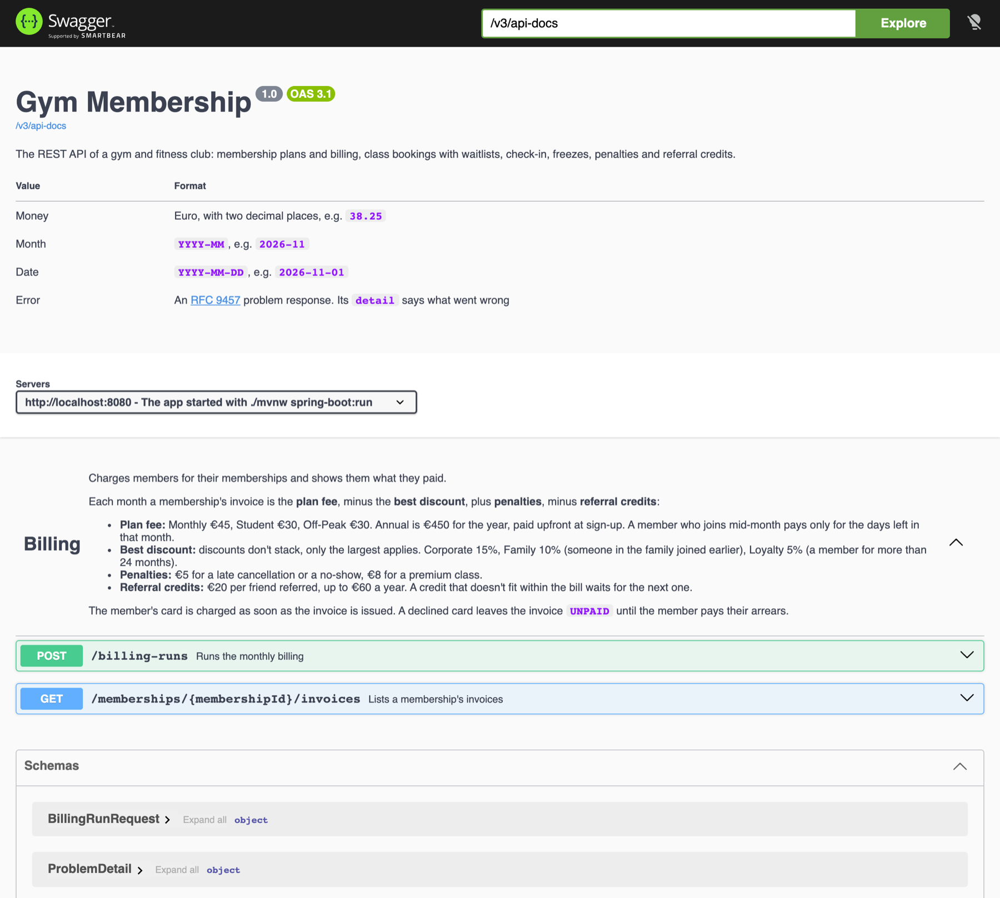

# Code

Everything that builds and runs lives here. The report material is in [../report](../report).

| Path | What goes there |
| --- | --- |
| `pom.xml`, `mvnw`, `src/` | The Spring Boot project (see [tech-stack.md](../report/tech-stack.md#setting-up-the-project)) |
| `postman/` | Our simulated front end: the OpenAPI spec and the Postman collection generated from it, see [Postman](#postman) |
| `data/` | The JSON files behind the repository adapters, created when the app first saves something. Not committed |

## Running it

You need a JDK 21 or newer. Maven comes with the wrapper. From this folder:

| Command | What it does |
| --- | --- |
| `./mvnw verify` | Compiles, runs every test (unit, integration and end-to-end, see [Tests](#tests)) and builds `target/gym-membership-*.jar` |
| `./mvnw verify`, then open `target/site/jacoco/index.html` and `target/reports/pmd.html` | Coverage and PMD reports. CI also runs CK, keeps all three as the `metrics` artifact of every run, and posts a summary as a comment on the pull request, with coverage for each kind of test |
| `./mvnw spring-boot:run` | Starts the app on http://localhost:8080. Check http://localhost:8080/actuator/health returns `UP` |

## Tests

Every test is one of three kinds, told apart by the end of its class name:

| Kind | Name ends in | What it tests | Run by | Examples |
| --- | --- | --- | --- | --- |
| Unit | `Test` | One class on its own, with in-memory fakes: no Spring, no files, no server. Also `ArchitectureTest` | Surefire, in the `test` phase | `BillingServiceTest`, `DiscountPolicyTest` |
| Integration | `IT` | Real wiring: the Spring application, the JSON files, the generated OpenAPI spec | Failsafe, after the jar is built | `JsonFileRepositoryIT`, `OpenApiSpecIT` |
| End-to-end | `E2E` | The whole app on a real port, through HTTP and the JSON files, as Postman uses it | Failsafe, after the jar is built | `BillingE2E` |

`./mvnw verify` runs all three. Leave kinds out with `-Dskip.unit`, `-Dskip.integration` or `-Dskip.e2e`, e.g. only the end-to-end tests:

```
./mvnw verify -Dskip.unit -Dskip.integration
```

CI runs each kind as its own check (**Unit tests**, **Integration tests**, **End-to-end tests**) and merges their coverage.

## Postman

Postman is our front end. Everything is in the public [Gym Membership workspace](https://www.postman.com/spaceflight-geoscientist-47956182/workspace/gym-membership), and its source is in `postman/`:

| Path | What it is | How it changes |
| --- | --- | --- |
| `specs/openapi.yaml` | The OpenAPI spec | Generated from the Javadoc on the controllers and DTOs, never edited by hand. `OpenApiSpecIT` fails the build when it's out of date |
| `collections/Gym Membership API` | Every endpoint, ready to send, with its docs, fields and real example responses | Generated from the spec, never edited by hand |
| `environments/local.environment.yaml` | `baseUrl` for the app on this machine | By hand |
| `environments/production.environment.yaml` | `baseUrl` for the live app on Railway, https://gym-membership-production-a725.up.railway.app. The collection already defaults to it, so this is only needed to switch back from another environment | By hand |
| `environments/mock.environment.yaml` | `baseUrl` for the workspace's public mock server, which answers every request with its saved example, so the API can be tried without the app. Add the header `x-mock-response-code: 404` to get an error example instead | By hand |

The app also serves the spec at `/v3/api-docs` and a browsable version, built from the same Javadoc, at its root address. Live, that is https://gym-membership-production-a725.up.railway.app/v3/api-docs and https://gym-membership-production-a725.up.railway.app:



**Documenting an endpoint.** Write Javadoc on the controller method (first sentence is the summary, then the details, `@param` and `@return`), on its controller class (the folder description) and on the request and response records (`@param` for each field). Declare each error response with `@ApiResponse` on the method, and add a real example response as `src/main/resources/openapi/examples/<method>-<status>.json`. Then regenerate:

```
./mvnw verify -Dskip.unit -Dit.test=OpenApiSpecIT -Dopenapi.write=true
postman spec sync collection postman/specs/openapi.yaml --force
```

**Trying it.** Open **Gym Membership API** in the workspace and send any request: it goes to the live app, so there is nothing to install. Pick the **mock** environment to get the saved examples instead, or start the app and pick **local** to try your own changes. The business rules are tested in JUnit, so the collection has no tests of its own.

## Deploying

The app runs on [Railway](https://gym-membership-production-a725.up.railway.app/swagger-ui.html) and redeploys on every merge to `main`:

| Path | What it is |
| --- | --- |
| `code/Dockerfile` | Builds the jar with Maven, then runs it on a Java 21 JRE. Tests and reports are skipped, since CI already ran them |
| `.railway/railway.ts` | The Railway project as code: the service built from `code/` on `main`, its health check on `/actuator/health`, and the `gym-data` volume mounted at `/data` for the JSON files |
| `server.port=${PORT:8080}` | In `application.properties`, so the app listens on the port Railway gives it |

To change the Railway setup, edit `.railway/railway.ts`, then from the repository root:

```
npm install --prefix .railway
railway config plan    # preview the changes
railway config apply   # apply them
```

Build and run the image locally with `docker build -t gym-membership code && docker run -p 8080:8080 gym-membership`.

## Packages

Package by layer with Hexagonal ports and adapters. The reasoning is in [report/architecture](../report/architecture/README.md#package-structure). Each package has a `package-info.java` saying what belongs in it.

| Package | Holds | May use |
| --- | --- | --- |
| `gym.controller` | REST controllers, `ErrorHandler` | `port.in`, `dto`, `domain` |
| `gym.dto` | Request and response records | `domain` |
| `gym.port.in` | Use-case interfaces | `domain` |
| `gym.port.out` | `Repository<T, ID>`, `PaymentGateway`, `NotificationSender` | `domain` |
| `gym.service` | Use-case implementations | `port.in`, `port.out`, `domain` |
| `gym.domain` | Domain model, business rules, `Money`, `Notification`, `NotFoundException`, `RuleViolationException` | The JDK only |
| `gym.adapter.persistence` | `JsonFileRepository` and each feature's JSON repository | `port.out`, `domain` |
| `gym.adapter.payment` | `FakePaymentGateway`, the simulated card provider | `port.out`, `domain` |
| `gym.adapter.notification` | `EventNotificationSender` and `NotificationLog`, delivering notifications over Spring's event bus | `port.out`, `domain` |
| `gym.adapter.logging` | `LoggingInterceptor` and other out-of-band services | `interceptor` |
| `gym.interceptor` | The Interceptor pattern: interceptor, context, dispatcher, proxy | Nothing in `gym`, so it works with any use case |

`ArchitectureTest` checks these rules, so a wrong import fails the build. If it fails, fix the dependency rather than the test.

## Shared building blocks

Use these instead of writing your own:

| Need | Use |
| --- | --- |
| A price, fee, discount or credit | `domain.Money`: always 2 decimal places, rounded half up. `Money.euros("45")`, `plus`, `minus`, `percent(15)`, `proRata(12, 30)`, `min` |
| Take a payment | Inject `port.out.PaymentGateway` and call `charge(memberId, amount)`. It returns `false` when the card is declined. List member ids under `gym.payment.declined-members` in application.properties to demo a decline |
| Tell a member something | Inject `port.out.NotificationSender` and call `send(new Notification(memberId, subject, message))`. For now `NotificationLog` writes it to the log |
| The current time | Inject the `java.time.Clock` bean |
| A repository in a unit test | Extend `gym.support.InMemoryRepository` (test sources): no files, no Spring |
| Members and memberships | `domain.Member`, `domain.Membership` (with `PlanType` and `MembershipStatus`) and their `MemberRepository` and `MembershipRepository` ports, stored in members.json and memberships.json. They only hold data so far: Member and Membership add their behaviour, State and Factory on top |
| Charge a fee or penalty | Inject `port.in.RecordChargeUseCase` and call `record(membershipId, ChargeType.NO_SHOW, Money.euros(5))`. It goes on the next invoice. `creditReferral(membershipId)` gives the referrer €20 and applies the yearly cap |
| Bill a sign-up or a cancellation | Inject `port.in.CalculateChargesUseCase`: `billFirstMonth(membershipId, joined)` in UC1, `billFinal(membershipId)` in UC6 and UC13. Both take the payment and return the `Invoice`, whose `status` says whether it was paid |
| Pay arrears | Inject `port.in.PayArrearsUseCase` and call `payArrears(membershipId)` in UC14. An empty list means the card was declined, so the membership stays Lapsed |

## Adding your feature

Taking Booking as the example:

1. `domain`: `GymClass`, `Booking`, `Waitlist` and their rules. Throw `RuleViolationException` when a rule is broken and `NotFoundException` for an unknown id. The `ErrorHandler` turns them into 422 and 404 responses.
2. `port.out`: `interface GymClassRepository extends Repository<GymClass, String>`.
3. `adapter.persistence`: `JsonFileGymClassRepository extends JsonFileRepository<GymClass, String> implements GymClassRepository`. The Javadoc on `JsonFileRepository` shows the constructor.
4. `port.in`: `BookClassUseCase`, taking ids and values rather than DTOs.
5. `service`: `BookingService implements BookClassUseCase`. Inject the `java.time.Clock` bean instead of calling `now()`, so tests can fix the date.
6. `dto` and `controller`: `BookingRequest`, `BookingResponse` and `BookingController`, which calls `BookClassUseCase`.
7. Tests: unit-test the rules in `domain` and `service` with an in-memory fake of the repository port (extend `gym.support.InMemoryRepository`), plus a test for your design pattern.

## Adding an out-of-band service

Every call to a `port.in` use case already passes through the Interceptor pattern ([report/architecture](../report/architecture/README.md#pattern-3-interceptor-covered-in-lectures-week-7)), so logging, timing or auditing never goes into a controller or service:

1. Write a class in `adapter/` that implements `UseCaseInterceptor` and overrides `onBefore`, `onAfter` or `onFailure`. `UseCaseContext` gives you the use case, arguments, result, failure and elapsed time.
2. Register it in `InterceptorConfiguration` with a priority. Lower runs first on the way in and last on the way out.
