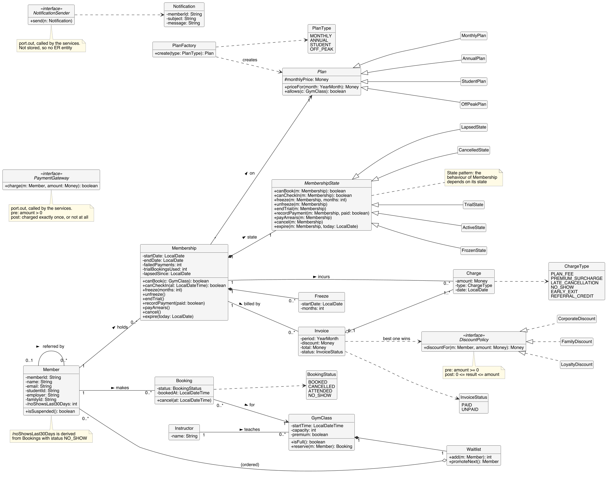
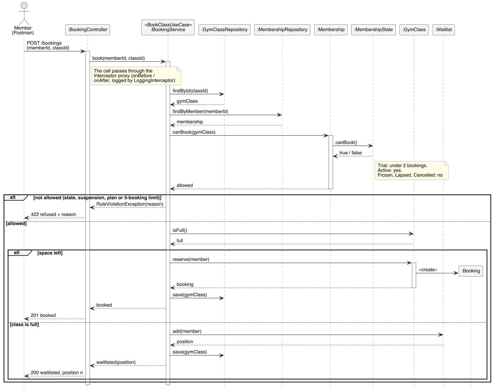
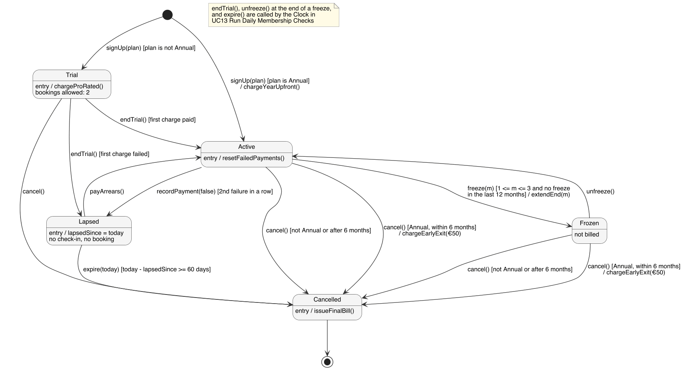
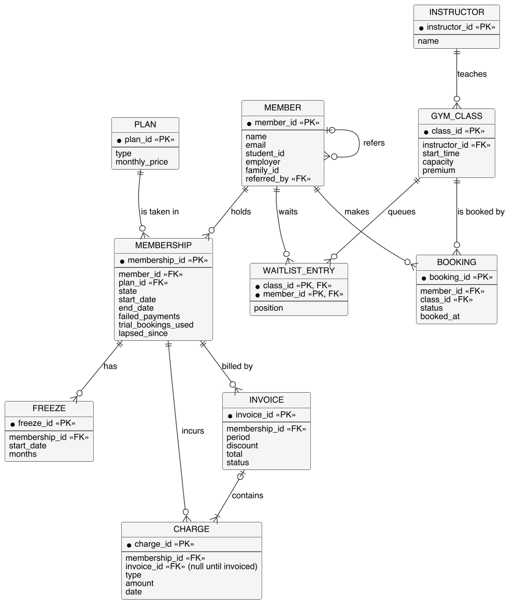

# Analysis sketches (report §6)

> **Bootstrap draft (GenAI, prompts #6–7 in [genai-prompts.md](../genai-prompts.md)).** The Systems Analyst should challenge these, redraw them by hand (the spec allows photographed sketches, and photos of our rough work go in [../sketches](../sketches/README.md)), and write the report text in our own words.

| Required by §6 | Diagram |
| --- | --- |
| Candidate objects | [below](#candidate-objects) |
| Class diagram |  |
| Sequence diagram |  |
| State chart (object from the sequence diagram) |  |
| ER diagram with cardinality |  |

## Candidate objects

Found by noun identification (Lecture B method) over [UC1](../requirements/use-cases/UC1-sign-up-for-membership.md), [UC2](../requirements/use-cases/UC2-book-class.md) and the [business rules](../requirements/README.md#business-rules). Kept candidates have state, behaviour and identity.

| Noun | Source | Decision | Reason |
| --- | --- | --- | --- |
| Member, Prospective Member | UC1, UC2 | **Keep:** `Member` | Prospective Member is the same object before sign-up, so it isn't a separate class |
| Membership | UC1, BR-M2–M5 | **Keep** | Has a lifecycle (Trial → Active → ...), so it gets the state chart |
| Plan (Monthly, Annual, Student, Off-Peak) | BR-M1 | **Keep:** `Plan` with subclasses | Different pricing and access rules, so a generalisation |
| Trial, Active, Frozen, Lapsed, Cancelled | BR-M2–M4 | **Keep:** `MembershipState` subclasses | Behaviour varies by state (State pattern) |
| Freeze | BR-M3 | **Keep** | Needed to check "at most once per 12 months" |
| Class (timetable entry) | UC2, BR-B1 | **Keep:** `GymClass` | `Class` clashes with `java.lang.Class` |
| Timetable | UC2 | Discard | A query over `GymClass` by date, not an object |
| Waitlist | BR-B1, BR-B2 | **Keep** | Ordered, first-come first-served, promotes on cancel (Observer subject) |
| Booking | UC2, BR-B3–B6 | **Keep** | Links Member and GymClass and has its own status, so an association class |
| No-show, late cancellation | BR-B3, BR-B4 | Discard as classes | They are `BookingStatus` values and `ChargeType` values |
| Instructor | Actors | **Keep** | Teaches classes and records attendance (UC8) |
| Payment | UC1, BR-M4 | Discard as an entity | It's an outcome from the `PaymentGateway` port. `failedPayments` is kept on Membership |
| Payment Gateway | UC1 | **Keep** as an interface (`port.out`) | External system, so it sits behind a port |
| Price, fee, penalty, surcharge, credit | BR-P1 | **Keep:** `Charge` + `ChargeType` | One class, many kinds, so no duplicated attributes |
| Invoice | UC1, BR-P1 | **Keep** | Groups the charges for one period |
| Discount (Corporate, Family, Loyalty) | BR-P2 | **Keep:** `DiscountPolicy` | Interchangeable rules, best one wins (Strategy) |
| Referral, referral code | UC1, BR-P3 | Attribute + reflexive association on `Member` | The credit itself is a `Charge` of type `REFERRAL_CREDIT` |
| Student ID | BR-M1 | Attribute of `Member` | No behaviour of its own |
| Notification | UC1, BR-B2 | **Keep** as an interface (`NotificationSender`) | Delivered by an adapter (Observer listener) |
| Personal details, payment details | UC1 | Discard | Attributes, or handled outside the system |
| Front Desk Staff, Manager | Actors | Discard for now | Only roles for authorisation. No business state |

## Kept deliberately simple

These are analysis **sketches**, so they show the main classes and only the attributes and operations the business rules need. The class diagram already shows where two patterns will go, because the rules call for them: the `MembershipState` hierarchy (State, from the state chart) and `PlanFactory` (Factory, one place to create the four plans). The other patterns (Strategy behind `DiscountPolicy`, Command for bookings, Observer for `Waitlist`) are added in the design and implementation iterations.

## Checklist against the §6 marking criteria

- [x] Inheritance: `Plan` → `MonthlyPlan`, `AnnualPlan`, `StudentPlan`, `OffPeakPlan` (all four BR-M1 plans), and `MembershipState` → the five states
- [x] Realisation: `CorporateDiscount`, `FamilyDiscount` and `LoyaltyDiscount` implement `DiscountPolicy` (BR-P2)
- [x] Composition: `GymClass ◆ Waitlist`, `Membership ◆ MembershipState`, `Membership ◆ Freeze`
- [x] Aggregation: `Invoice ◇ Charge`
- [x] Associations with multiplicity: `Member`–`Membership`, `Member`–`Booking`, `Booking` → `GymClass`, `Membership` → `Plan`, `Instructor`–`GymClass`, `Membership`–`Invoice`, `Membership`–`Charge`, and the reflexive referral on `Member` (BR-P3)
- [x] Dependencies: `Invoice` uses `DiscountPolicy`, `PlanFactory` creates `Plan`. `PaymentGateway` is a `port.out` interface called by the services, so no domain class depends on it (the Hexagonal rule)
- [x] Visibility: `+`, `-`, `#`
- [x] Enumerations: `PlanType`, `BookingStatus`, `ChargeType`, `InvoiceStatus`
- [x] Interfaces with pre/postconditions: `DiscountPolicy`, `PaymentGateway`. `NotificationSender` is the other `port.out` interface
- [x] Derived attribute: `/noShowsLast30Days`, counted from `NO_SHOW` bookings, so it has no ER column
- [x] No duplicated attributes or operations
- [x] Sequence diagram contains `Membership`, the object with the state chart
- [x] The state chart is for the same object the State pattern implements (`Membership`), so the analysis, the code and the recovered diagrams tell one story
- [x] State chart transitions annotated as `event [guard] / action`
- [x] ER diagram with crow's foot cardinality
- [x] Every state chart event is an operation on `Membership` and `MembershipState`, and every guard reads an attribute in the class diagram

## How the diagrams agree

The class diagram has more boxes than the ER diagram has entities, and that is expected: only classes whose data is stored become entities. Each stored class has exactly one entity, with the same attributes and the same multiplicities.

| Class | Entity | Note |
| --- | --- | --- |
| `Member` | `MEMBER` | `referred_by` is the reflexive referral. `/noShowsLast30Days` is derived, so it has no column |
| `Membership` | `MEMBERSHIP` | The `MembershipState` composition is stored as the `state` column |
| `Plan` and its 4 subclasses | `PLAN` | One table, told apart by `type` (`PlanType`) |
| `Freeze` | `FREEZE` | |
| `Invoice` | `INVOICE` | `total` is stored once the invoice is issued |
| `Charge` | `CHARGE` | Belongs to a `Membership`. `invoice_id` stays null until the charge is invoiced, matching `Invoice 0..1 ◇ Charge` |
| `Instructor` | `INSTRUCTOR` | |
| `GymClass` | `GYM_CLASS` | |
| `Booking` | `BOOKING` | |
| `Waitlist` | `WAITLIST_ENTRY` | The ordered `Waitlist`–`Member` link becomes one row per member, ordered by `position` |

Not stored, so no entity: the five `MembershipState` classes (a column), the four enumerations (columns), `DiscountPolicy` and its three strategies (behaviour only), `PlanFactory` (creation only), and the `PaymentGateway` and `NotificationSender` ports (outside systems). `Notification` is sent and not kept.

The other diagrams line up with the same names:

- **State chart ↔ class diagram:** each event (`endTrial()`, `freeze(m)`, `unfreeze()`, `recordPayment(false)`, `payArrears()`, `cancel()`, `expire(today)`) is an operation on `Membership`, delegated to `MembershipState`. Guards read `failedPayments`, `lapsedSince`, `trialBookingsUsed` and `Freeze` history.
- **State chart ↔ use cases:** the Member's events come from UC5, UC6 and UC14. The Clock's events (`endTrial()`, `unfreeze()` at the end of a freeze, `expire()`) come from UC13, and `recordPayment` from UC7.
- **Sequence ↔ class and ER diagrams:** every message is an operation in the class diagram, and each repository saves an ER entity (`Booking` through `BookingRepository`, the waitlist with its `GymClass`).

## Decisions on the open questions (24 Oct 2026, Business Analyst)

- **Trial payment:** a Trial member pays a pro-rated first charge at sign-up (UC1, step 6), and the trial becomes Active when the trial ends and that payment has gone through. If it failed, the membership goes to Lapsed. An Annual plan is paid upfront for the year, so it skips the Trial and starts Active. Recorded in BR-M2.
- **Lapsed timeout:** a membership that stays Lapsed for 60 days without the arrears being paid is cancelled automatically, with a final bill. Recorded as BR-M6.
- **Family memberships:** out of scope for Part 1. Each member pays for their own membership, so `Member` has no payer association. The Family discount (BR-P2) still applies to the second and later members of a family, so `Member` keeps a `familyId` to group them (and an `employer` for the Corporate discount).

The state chart shows all three decisions, and every state can now reach Cancelled.
