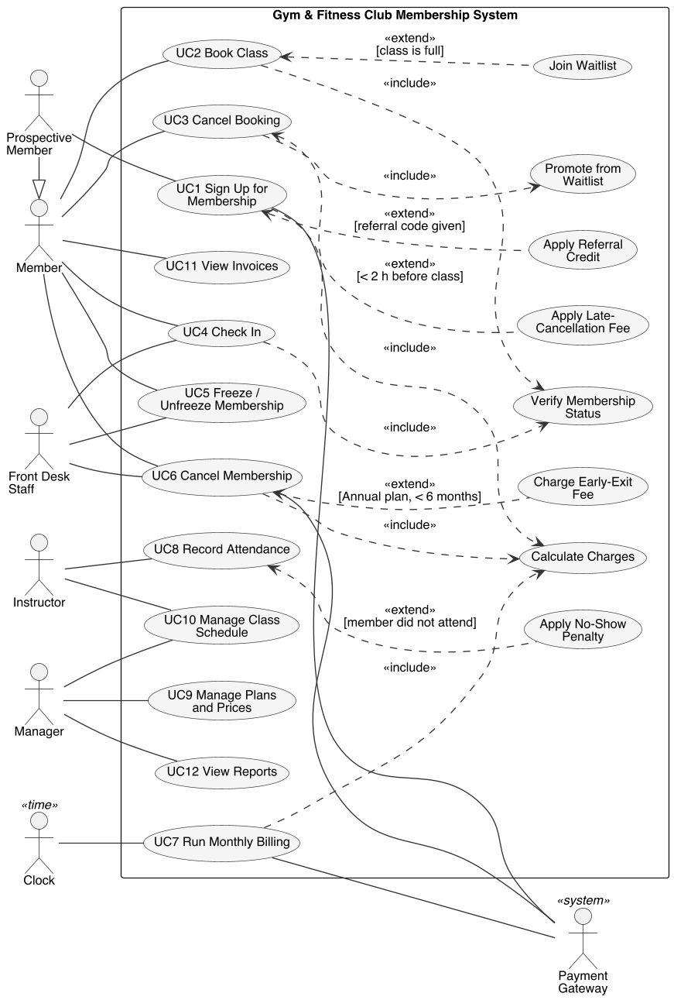
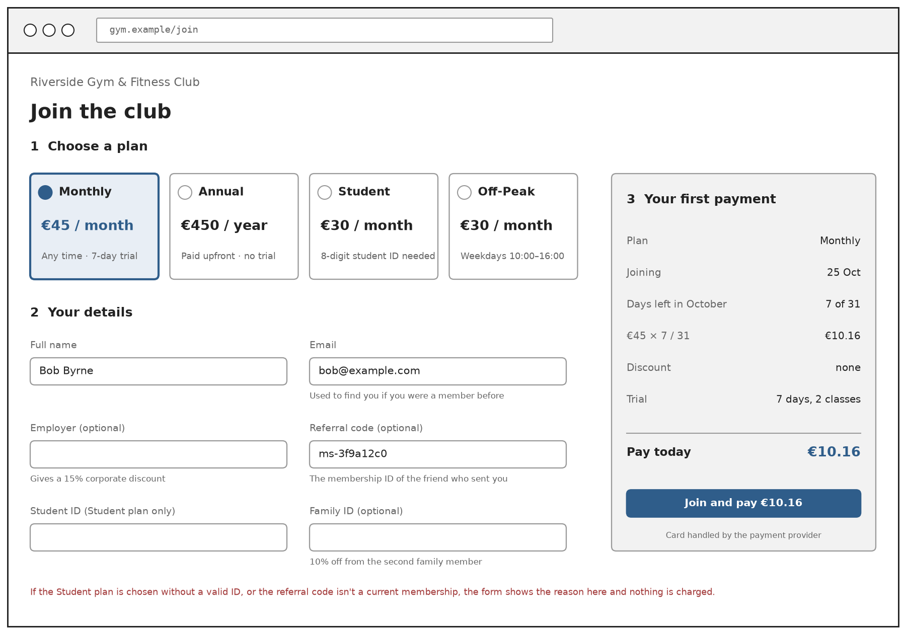
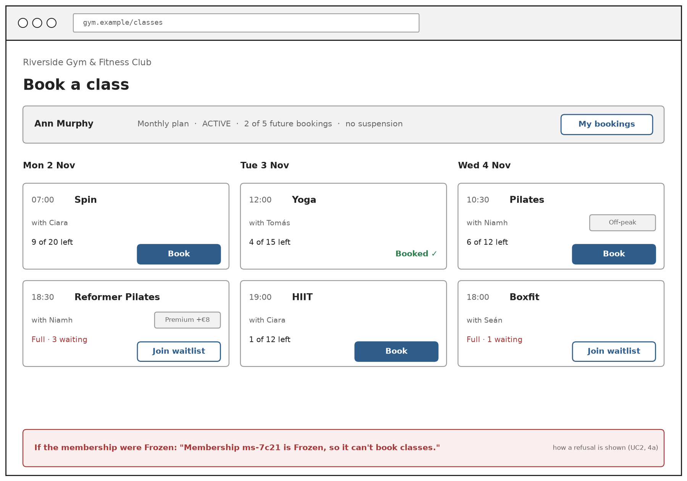

# Requirements {#requirements}

<!--
Owner: Dhruv.
The use case diagram, UC1 and UC2 in the Week 2 template (with extensions, variations and open issues), two quality
attributes as six-part scenarios (one must be extensibility) with named Bass et al. (2019) tactics and the class that
applies each one, and two GUI prototypes.
The use case drafts in report/requirements/use-cases came from GenAI (prompt #2): rewrite them in your own words.
-->

## Use Cases

*Introduction to the actors and use cases, to be written by Dhruv.*

## UC1: Sign Up for Membership

*To be written by Dhruv.*

## UC2: Book Class

*To be written by Dhruv.*

## Quality Attributes

*QA1 (extensibility) and QA2, each as a six-part scenario with its tactics, to be written by Dhruv.*

## GUI Prototypes

The two prototypes are for the two key use cases. They are wireframes of screens the prototype doesn't have yet: today the same requests are made through Postman or the Swagger UI.

{width=100%}

The Join screen follows UC1 from top to bottom. The four plans show their price and the rule that sets them apart (BR-M1), and the form asks only for what the rules need: the email to recognise a past member, the employer and family ID for discounts, the referral code, and the student ID for the Student plan. The first payment is worked out on the screen before the person pays, here Bob joining a Monthly plan on 25 October with 7 of 31 days left, €45 × 7/31 = €10.16 (BR-P4), with the trial it starts (BR-M2). Refusals from extensions 5a and 5b appear under the form before anything is charged.

{width=100%}

The Book a Class screen follows UC2. The bar at the top shows what the system checks before a booking: the plan, the membership's state, how many of the 5 future bookings are used (BR-B5) and whether the member is suspended (BR-B4). Each class shows its places left (BR-B1), with Book while there is space and Join waitlist once it is full (the «extend»), together with the number already waiting. Premium classes are marked with their €8 surcharge (BR-B6) and off-peak classes are marked for Off-Peak members (BR-B5). When a booking is refused, the reason the membership gives is shown at the bottom, as in extension 4a.
