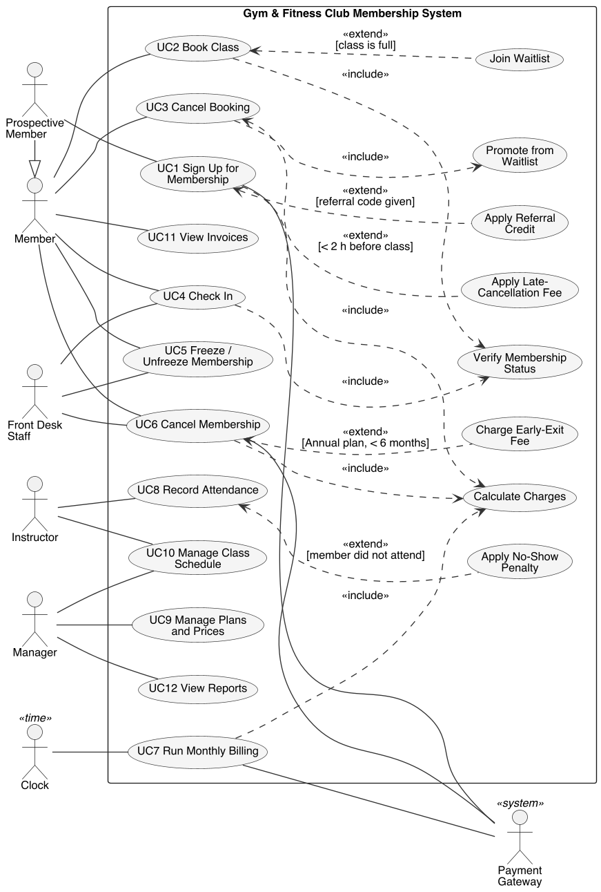
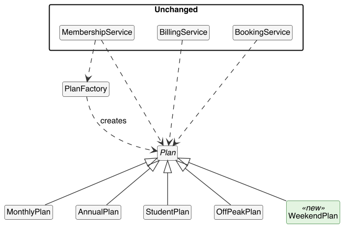
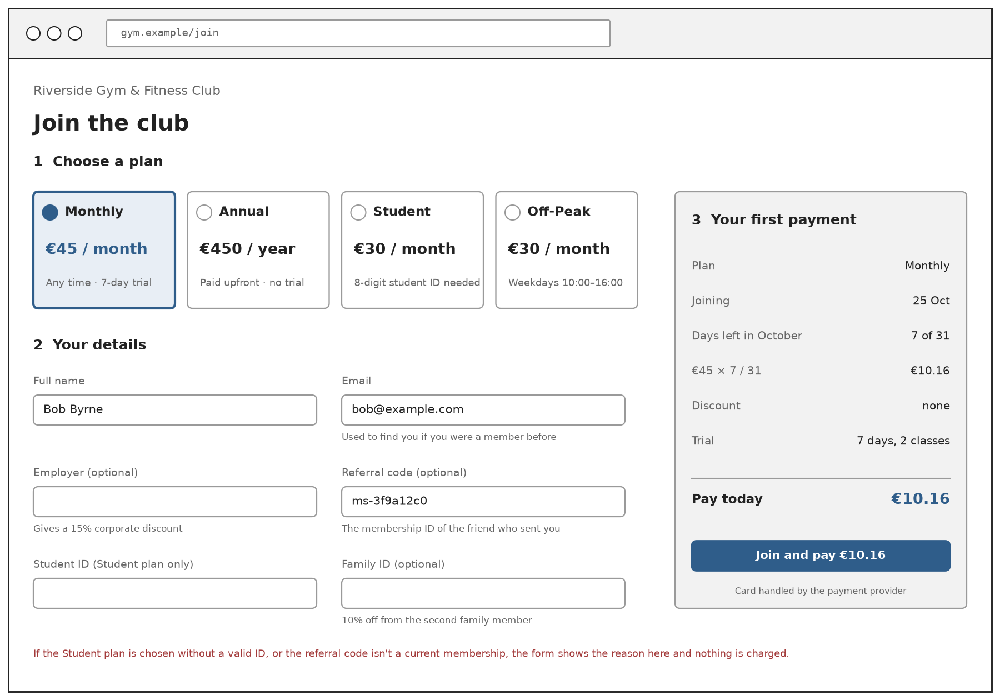
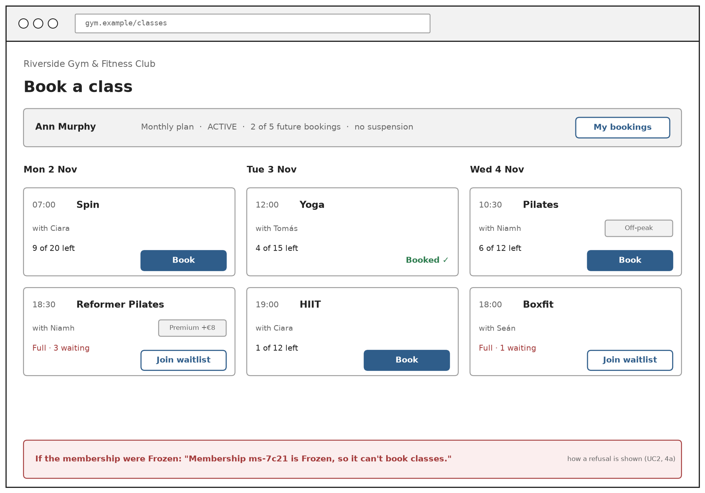

# Requirements {#requirements}

<!--
Owner: Dhruv.
The use case diagram, UC1 and UC2 in the Week 2 template (with extensions, variations and open issues), two quality
attributes as six-part scenarios (one must be extensibility) with named Bass et al. (2019) tactics and the class that
applies each one, and two GUI prototypes.
-->

## Use Cases

{height=13cm}

In our use case diagram we took 5 human actors - Prospective Member, Member, Front Desk Staff, Instructor and Manager. Member is a specialisation of Prospective Member: a Prospective Member is someone new who can only sign up, while a Member can also rejoin a membership.

The two non-human actors were a Clock and a Payment Gateway. Having these was going a bit too in depth, as discussed with our professor during the lecture, but we kept them anyway as they made sense to us for future exploration of use cases as well.

Steps shared between use cases are pulled out with «include», like Calculate Charges and Verify Membership Status, and optional ones are «extend» with the condition written on them, for example Join Waitlist only happens when the class is full.

Below we explain UC1 (Sign Up) and UC2 (Book a Class) in detail, as we believe they are the primary use cases of our application and touch most of the logic we worked on.

Only UC9 (Manage Plans and Prices) and UC12 (View Reports) are not fully built out in our current implementation.

```{=typst}
#v(1em)
```

## UC1: Sign Up for Membership

| Use case 1 | Sign Up for Membership |
| --- | --- |
| Goal in Context | A person joins the gym on one of our four plans and pays for what's left of the first month (or the whole year on Annual) |
| Scope & Level | Gym membership system, user goal |
| Preconditions | The plans and prices are set up (BR-M1), and the person doesn't already hold a membership that isn't cancelled |
| Success End Condition | The membership starts in Trial (or Active on Annual), the first invoice is created and a welcome message is sent. If they were referred, the referrer gets their credit |
| Failed End Condition | Nothing is saved and nothing is charged |
| Primary, Secondary Actors | Prospective Member; Payment Gateway |
| Trigger | The person clicks Join |

**Main success scenario**

1. The system shows the four plans with their price, trial and access hours (BR-M1)
2. The person picks a plan and enters their name and email, and a student ID, employer, family ID or referral code if they have one
3. The system checks they are eligible for the plan and that the referral code is real. If the email belongs to a past member, it reuses their member record
4. The system starts the membership: a 7-day Trial with 2 bookings, or Active straight away on Annual (BR-M2)
5. The system works out the first bill, pro-rated for the days left (BR-P4) minus the best discount (BR-P2), «include» Calculate Charges, and charges the card
6. The payment goes through, the referrer gets €20, «extend» Apply Referral Credit (BR-P3), and the welcome message is sent

**Extensions**

- **3a:** Student plan without a valid 8-digit ID, a referral code that doesn't exist, or a past member who still has a live membership: the system refuses, says why, and saves nothing
- **6a:** The card is declined: the membership is still created but the invoice stays unpaid and no referral credit is given. When the trial ends it goes to Lapsed until they pay (UC14)

**Variations**

- **2:** Monthly €45, Student €30, Off-Peak €30, or Annual €450 paid upfront with no trial
- **5:** Corporate 15% or Family 10%. Loyalty 5% needs 24 months, so it never applies at sign-up

| **Related information** | |
| --- | --- |
| Priority / Performance / Frequency | Top priority; under 2 seconds including the payment; around 20 a day |
| Channel to actors | REST `POST /memberships` (through Postman or Swagger UI), and the Join screen prototype |
| Open issues | Should a declined Annual payment be refused instead of starting Active? Family memberships with one payer were left out of scope (24 Oct) |
| Due Date / Superordinates | Release 0.2.0 (done) / Manage memberships |
| Subordinates | Calculate Charges, Apply Referral Credit |

```{=typst}
#v(1em)
```

## UC2: Book Class

| Use case 2 | Book Class |
| --- | --- |
| Goal in Context | A member gets a place in a class, or a place on its waitlist when it's full |
| Scope & Level | Gym membership system (Booking), user goal |
| Preconditions | The member has a membership, and the class is on the timetable and hasn't started yet |
| Success End Condition | The member has a confirmed booking or a waitlist position, any premium surcharge is recorded, and a Trial booking is counted |
| Failed End Condition | Nothing is booked or charged, and the member is told why |
| Primary, Secondary Actors | Member; Front Desk Staff when they book for a member |
| Trigger | The member picks a class and clicks Book |

**Main success scenario**

1. The member picks a class from the timetable
2. The system checks the member isn't suspended (3 no-shows in 30 days, BR-B4) and has fewer than 5 future bookings (BR-B5)
3. The system asks the membership if it can book, «include» Verify Membership Status. This depends on its state (Trial with under 2 bookings, or Active) and its plan (Off-Peak can only book off-peak classes)
4. The system checks the class still has a free place (BR-B1) and shows the €8 premium surcharge if there is one (BR-B6)
5. The member confirms, and the system creates the booking, records the surcharge and confirms it

**Extensions**

- **2a, 3a:** The member is suspended, already has 5 bookings, or their state or plan doesn't allow it (for example Frozen, or Off-Peak picking an evening class): the system refuses and gives the reason
- **4a:** The class is full: «extend» Join Waitlist. The member is told their position and gets booked automatically when a place frees up (BR-B2, UC3)

**Variations**

- **4:** Annual members and normal classes pay no surcharge. Front Desk Staff can also book on a member's behalf

| **Related information** | |
| --- | --- |
| Priority / Performance / Frequency | Top priority; under 1 second, and if two members race for the last place only one gets it; around 500 a day |
| Channel to actors | REST `POST /classes/{classId}/bookings`, and the Book a Class screen prototype |
| Open issues | Can a member book two classes that overlap? Should the waitlist still promote people within 2 hours of the start? |
| Due Date / Superordinates | Release 1.0 / Manage bookings |
| Subordinates | Verify Membership Status, Join Waitlist |

```{=typst}
#v(1em)
```

## Quality Attributes

We picked extensibility, which the specification asked for, and testability. Both are written as scenarios from Bass et al. (2019), and under each one we list the tactics we used and where they show up in our code.

```{=typst}
#v(1em)
```

### QA1: Extensibility

A gym will always want to add new plans, and each one comes with its own price, trial, hours and rules on who can join. We didn't want adding a plan to mean going through sign-up, billing and booking and changing all of them, so this was the quality we cared about the most.

| Part | QA1: adding a plan |
| --- | --- |
| Source / Stimulus | A developer, after the manager asks for a new Weekend plan at €25 a month |
| Artefact / Environment | The plan classes in `domain` and `PlanFactory`, at design time |
| Response | One new `Plan` subclass, one new `PlanType` value and one line in `PlanFactory`, plus their tests |
| Response measure | No changes to `MembershipService`, Billing, Booking or the controllers; the new plan shows up in `GET /plans`; all tests pass; done in under a day |

Adding a Weekend plan, with the three modifiability tactics we used marked on it (new parts in green):

{width=85%}

The same idea works for discounts (another `DiscountPolicy`) and membership states (another `MembershipState`), and `PlanFactoryTest` fails if a `PlanType` has no class.

```{=typst}
#v(1em)
```

### QA2: Testability

Most of our rules depend on dates, like the 7-day trial or being Lapsed for 60 days. We obviously can't wait 60 days to see if a test passes, so we needed every rule to be testable quickly and give the same result every time, without charging any real card or writing any files.

| Part | QA2: testing a time-based rule |
| --- | --- |
| Source / Stimulus | A developer or CI, after a rule changes, for example the 60-day Lapsed rule (BR-M6) |
| Artefact / Environment | The services and domain classes, with no network, database or payment provider |
| Response | Unit tests move a test clock forward and use in-memory repositories and a fake payment gateway |
| Response measure | Every rule we built has a unit test; all 254 unit tests run without files, network or the real clock; a failing test blocks the merge |

Tactics (testability):

- **Limit nondeterminism:** services take a `java.time.Clock`, and tests pass in a `TestClock`, so "60 days later" happens instantly and the same way every run.
- **Abstract data sources:** services only see the `port.out` repositories, so tests can swap in `InMemoryRepository`.
- **Specialised interfaces:** `PaymentGateway` and `NotificationSender` are ports too, so tests use fakes that decline the cards we choose and record every message sent.

```{=typst}
#v(1em)
```

## GUI Prototypes

These are the wireframes for our two key use cases. We didn't build actual screens, since the business logic was our focus, so for now the same requests go through Postman or Swagger UI.

::: {.grid columns=2}
{width=100%}

{width=100%}
:::

**Join screen** (UC1):

- It follows UC1 from top to bottom, and only asks for what our rules actually need.
- It shows the first payment before the person pays. For example, Bob joining on 25 October pays €45 × 7/31 = €10.16 for the rest of the month (BR-P4).
- If extension 3a refuses them, the reason shows up under the form before anything is charged.

**Book a Class screen** (UC2):

- The bar at the top shows everything checked before a booking: the plan, the state, how many bookings are used and whether they are suspended.
- Each class shows how many places are left, with a Book or Join waitlist button, and premium classes show the €8 surcharge.
- When a booking is refused, the reason from the membership is shown, like in extension 2a.
