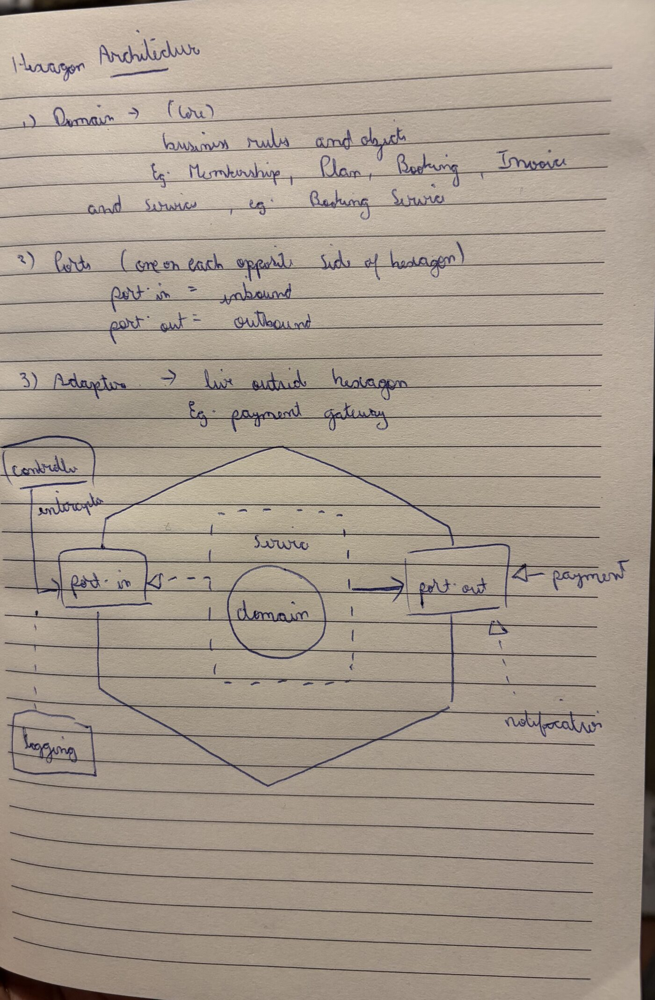
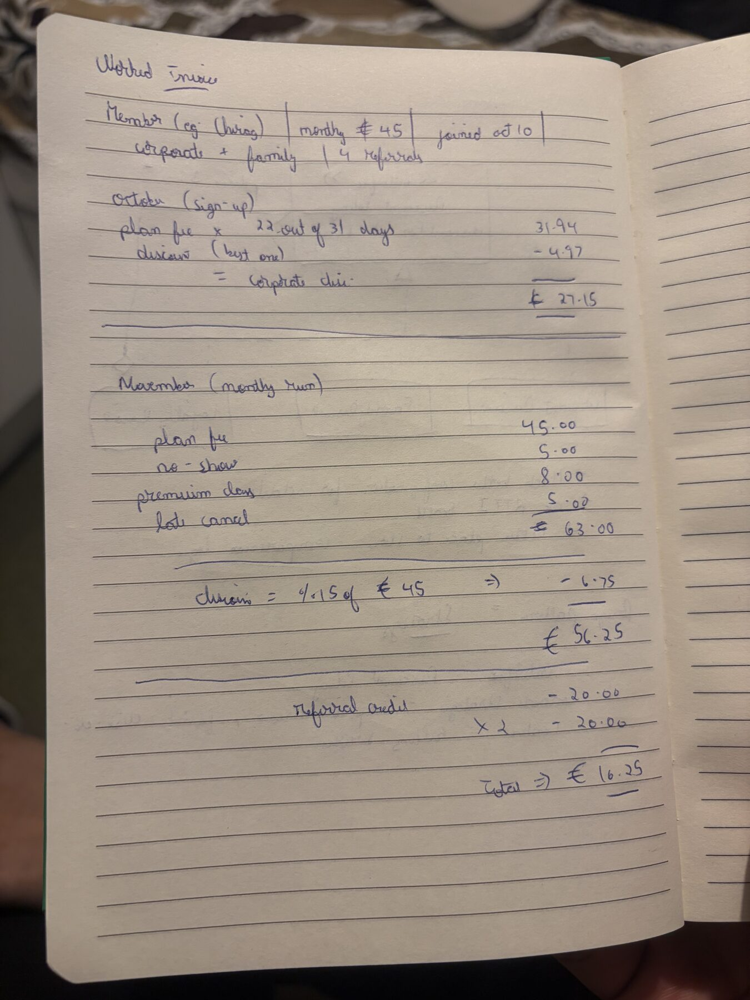
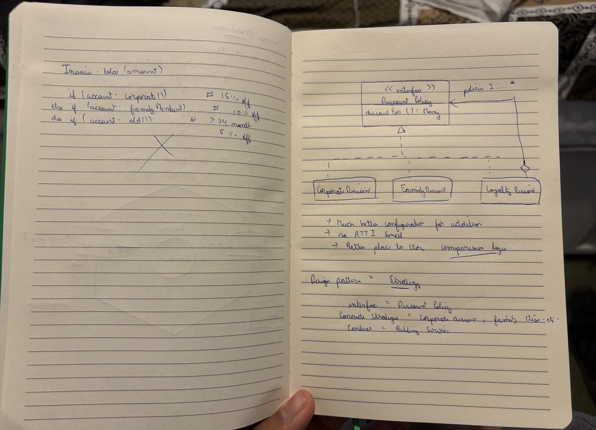
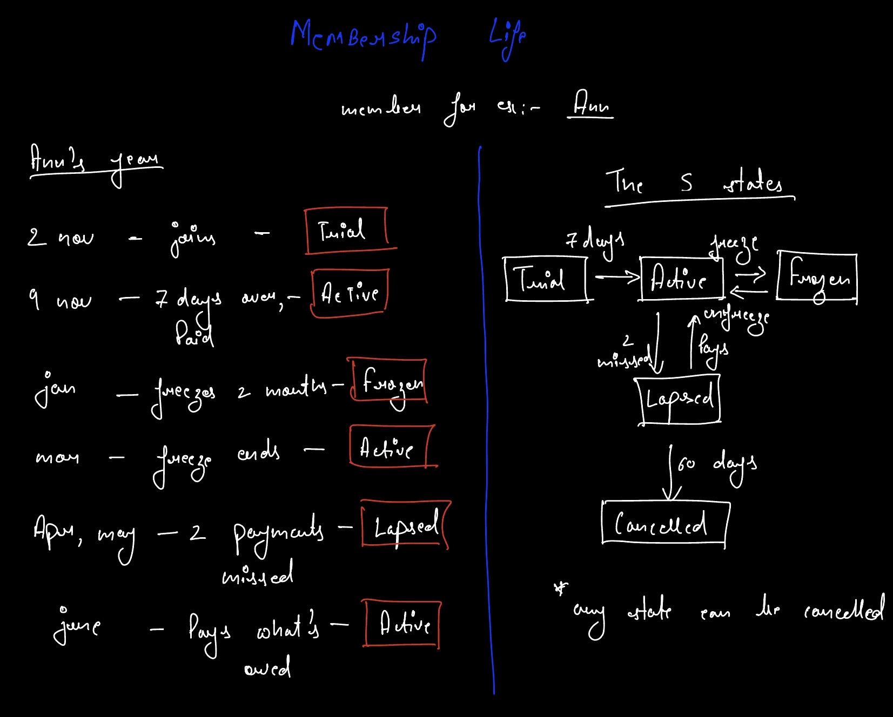
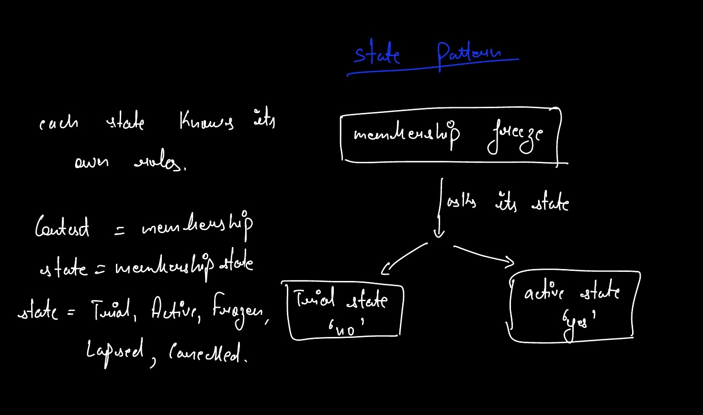
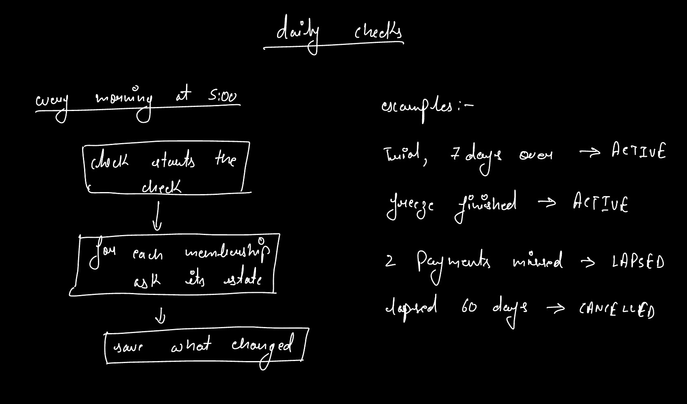
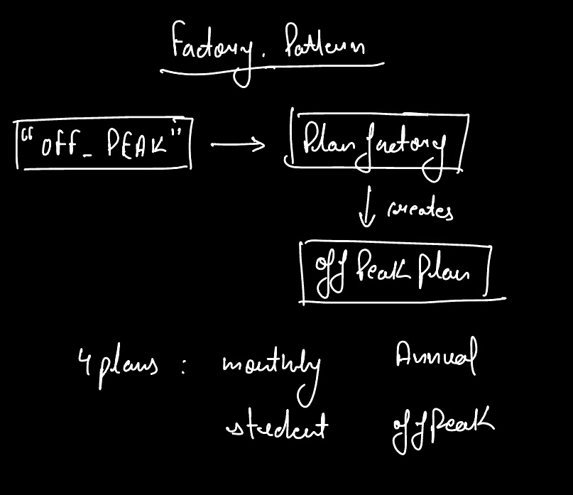
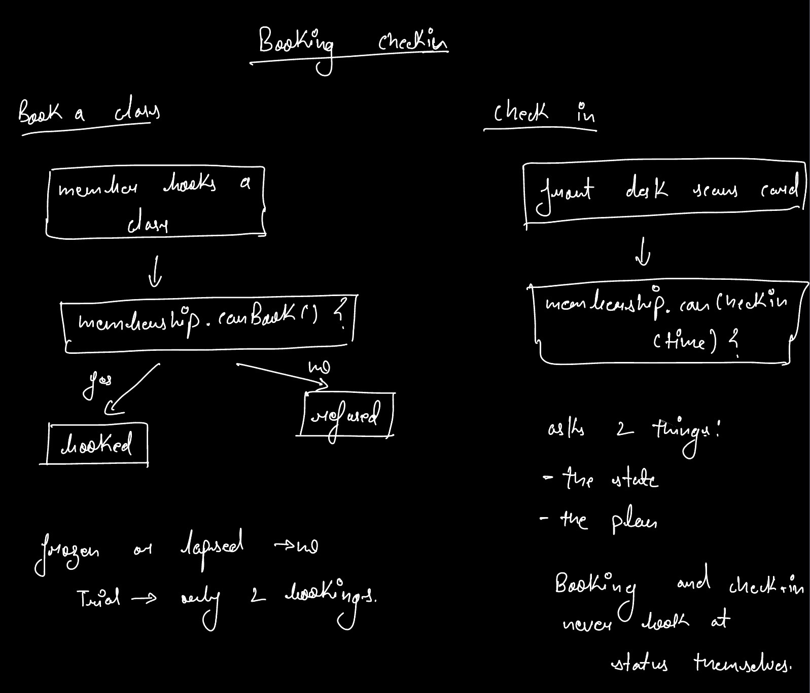
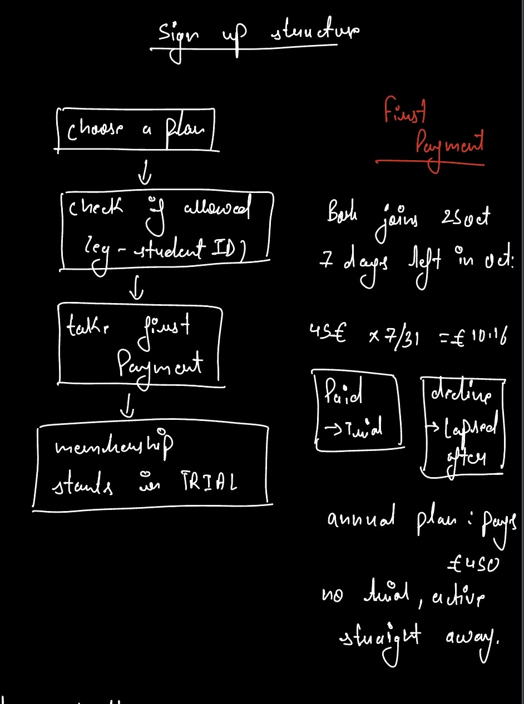

# Analysis Sketches {#analysis-sketches}

<!--
Owner: Dhruv.
Candidate objects and how we found them, the class diagram (interfaces with pre- and postconditions), the sequence
diagram, the Membership state chart (the object in the sequence diagram), and the ER diagram. Put each photo of our
rough work next to the clean diagram it led to, with what changed.
Evidence: report/analysis/README.md, report/sketches/README.md.
-->

## Candidate Objects

*To be written by Dhruv.*

## Class Diagram

## Sequence Diagram: Book Class

## State Chart: Membership

## Entity Relationship Diagram

## Rough Work

These are photos of our rough work, drawn by hand on paper or on an iPad, with crossings-out left in. Chirag's three sketches worked out the hexagon, the discount Strategy and an invoice by hand. Mine follow the Membership feature: one member's year through the five states, the State pattern answering whether a membership may freeze, the Plan Factory, sign-up with a worked first payment, the daily checks, and how booking and check-in ask a membership what it allows. The layout of each was copied from a GenAI reference page and redrawn by hand. What changed between each sketch and the final diagram or code is recorded next to the photo in `report/sketches/README.md`; for example, the sign-up sketch writes prices in pounds instead of euros, and the State sketch shows only a yes or no where the code also checks the 1 to 3 month limit.

::: {.grid columns=2}
{width=100%}

{width=100%}

{width=100%}

{width=100%}

{width=100%}

{width=100%}

{width=100%}

{width=100%}

{width=80%}
:::
