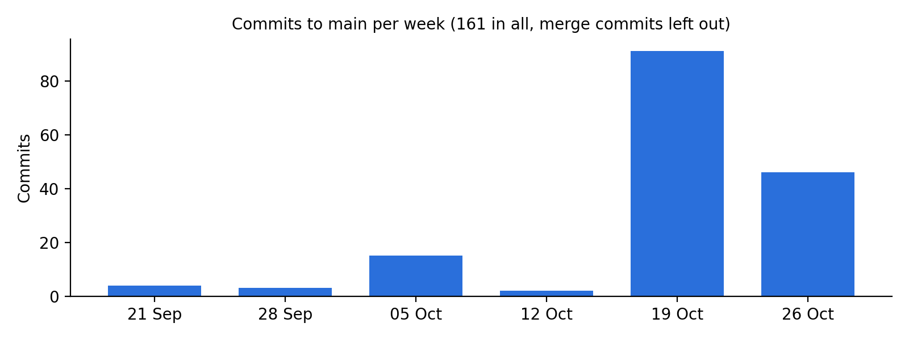
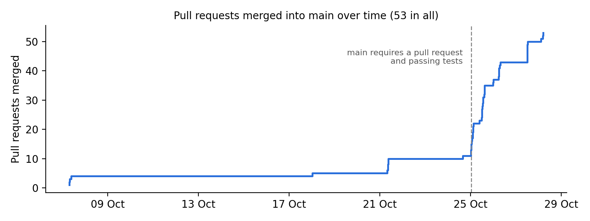

# Code {#code}

<!--
Everyone. One captioned snippet per pattern with the test that proves it, a table mapping each use case to the classes
that implement it, Hexagonal shown by ArchitectureTest, and the version control visualisations (commit graph,
contributors chart). Each pattern's owner writes its part.
Evidence: the Patterns table in the root README.md.
-->

## Use Cases and Their Classes

<!--
One or two sentences of your own: every use case enters through a controller (or a scheduled job), goes through its
port.in interface and lands in one service, so the table can be read left to right as the request's path.
-->

| Use case | Entry point | Port (`port.in`, without "UseCase") | Service | Domain classes |
| --- | --- | --- | --- | --- |
| UC1 Sign Up | `POST /memberships` | SignUp | MembershipService | PlanFactory, Plan, Member, Membership; Billing's CalculateCharges |
| UC5 Freeze / Unfreeze | `POST …/freeze`, `…/unfreeze` | FreezeMembership | MembershipService | Membership, Freeze, FrozenState |
| UC6 Cancel Membership | `POST …/cancel` | CancelMembership | MembershipService | Membership, CancelledState; Billing's final invoice and early-exit fee |
| UC7 Run Monthly Billing | BillingJob (monthly), `POST /billing-runs` | RunMonthlyBilling | BillingService | BestDiscount (Strategy), Charge, Invoice |
| UC11 View Invoices | `GET …/invoices` | ViewInvoices | BillingService | Invoice, Charge |
| UC13 Daily Checks | MembershipChecksJob (daily), `POST /membership-checks` | RunDailyChecks | MembershipService | TrialState, FrozenState, LapsedState |
| UC14 Pay Arrears | `POST …/pay-arrears` | RestoreMembership, PayArrears | MembershipService, BillingService | LapsedState, Invoice |

Table: Each use case built so far, from where it enters to the classes that carry it out ("…" is `/memberships/{membershipId}`)

<!-- UC2–UC4, UC8–UC10 and UC12 (bookings, attendance, plans, schedule, reports) aren't built yet. -->


## Architectural Patterns

*MVC, Hexagonal and Interceptor, each with a snippet and its test.*

```java
@ArchTest
static final ArchRule layersOnlyDependInwards = layeredArchitecture()
        .consideringOnlyDependenciesInLayers()
        .withOptionalLayers(true)
        // ... one layer per package
        .whereLayer("Controller").mayNotBeAccessedByAnyLayer()
        .whereLayer("Inbound port").mayOnlyBeAccessedByLayers("Controller", "Service")
        .whereLayer("Outbound port").mayOnlyBeAccessedByLayers("Service", "Adapter")
        .whereLayer("Service").mayNotBeAccessedByAnyLayer()
        .whereLayer("Adapter").mayNotBeAccessedByAnyLayer();

@ArchTest
static final ArchRule domainOnlyDependsOnTheJdk = classes()
        .that().resideInAPackage("gym.domain..")
        .should().onlyDependOnClassesThat()
        .resideInAnyPackage("gym.domain..", "java.lang..", "java.util..", "java.time..", "java.math..");
```

```java
@Bean
public UseCaseDispatcher useCaseDispatcher() {
    UseCaseDispatcher dispatcher = new UseCaseDispatcher();
    dispatcher.register(new LoggingInterceptor(), 0);
    return dispatcher;
}
```

## Design Patterns

*State and Factory (Dhruv), Observer (Bharat), each with a snippet and its test.*

### Strategy

<!--
Your words, 2–3 sentences. Facts:
- BR-P2: discounts don't stack; the member gets only the largest one they qualify for (corporate 15%, family 10%,
  loyalty 5% after more than 24 months).
- DiscountPolicy is the Strategy; CorporateDiscount, FamilyDiscount and LoyaltyDiscount are the concrete strategies.
- BestDiscount is itself a DiscountPolicy that asks every policy and keeps the largest, so BillingService only ever
  sees one DiscountPolicy (BillingService.java, `discounts.discountFor(account, planFees)`).
- BillingConfiguration chooses the list, so a new discount is a new class plus one entry there, with no change to
  BillingService. It is the same kind of change as the QA1 modifiability scenario (a new plan), but for discounts.
-->

```java
public interface DiscountPolicy {
    Money discountFor(BillingAccount account, Money amount);
}

public class FamilyDiscount implements DiscountPolicy {
    @Override
    public Money discountFor(BillingAccount account, Money amount) {
        return account.familyMember() ? amount.percent(10) : Money.ZERO;
    }
}

public class BestDiscount implements DiscountPolicy {
    private final List<DiscountPolicy> policies;

    @Override
    public Money discountFor(BillingAccount account, Money amount) {
        Money best = Money.ZERO;
        for (DiscountPolicy policy : policies) {
            best = best.max(policy.discountFor(account, amount));
        }
        return best;
    }
}
```

*The Strategy and two of its strategies (`gym/domain`, constructor and comments left out)*

```java
@Bean
public DiscountPolicy discountPolicy() {
    return new BestDiscount(List.of(
            new CorporateDiscount(), new FamilyDiscount(), new LoyaltyDiscount()));
}
```

*Choosing the strategies (`gym/BillingConfiguration.java`)*

```java
@Test
void theBestDiscountWinsAndDiscountsDontStack() {
    // BR-P2: corporate (15%), family (10%) and loyalty (5%) all apply,
    // but only the 15% is taken
    BillingAccount everything = account(true, true, 36);

    assertEquals(Money.euros("6.75"), best.discountFor(everything, FEE));
}
```

*The test that proves discounts don't stack (`DiscountPolicyTest`, fee €45)*

## Automated Tests

<!--
A sentence or two of your own. Facts:
- JUnit 5 throughout. Unit tests use in-memory fakes of the driven ports (test/support: InMemoryRepository,
  TestClock), which Hexagonal makes possible; integration tests start Spring; end-to-end tests call the REST API.
- Each kind runs as its own CI job on every pull request; since 25 Oct, a pull request can't merge unless all three
  pass.
- Coverage is merged across the three kinds by JaCoCo in the Metrics job.
-->

| Kind | Tests | Line coverage |
| --- | --- | --- |
| Unit | 101 | 75.4% |
| Integration | 20 | 40.6% |
| End-to-end | 11 | 74.0% |
| **All** | **132** | **95.8%** (801 of 836 lines) |

Table: Automated tests on main (CI run of 28 Oct)

## Version Control

<!--
A sentence or two of your own. Facts:
- 53 pull requests merged into main, 2 of them from Dependabot (#12 was merged into a feature branch, so it isn't
  counted). CI has run the tests on every pull request since 21 Oct, and the report build since 25 Oct.
- 16 commits went straight to main without a pull request, the last on 24 Oct. Since 25 Oct (the dashed line) a
  ruleset on main requires a pull request and the three test jobs to pass.
- Both charts are drawn from the git history by report/version-control/charts.py.
-->

{width=100%}

{width=100%}
