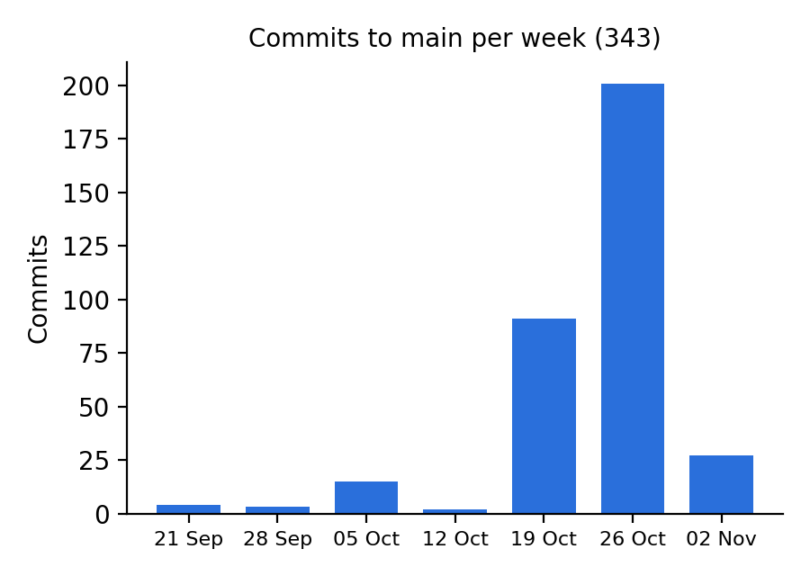
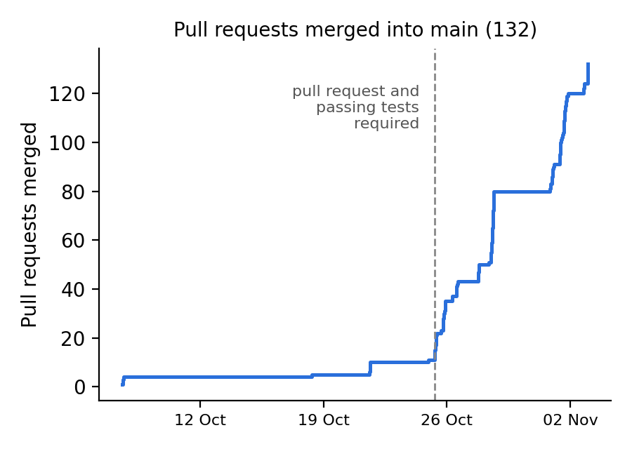

# Code {#code}

<!--
Everyone. One captioned snippet per pattern with the test that proves it, a table mapping each use case to the classes
that implement it, Hexagonal shown by ArchitectureTest, and the version control visualisations (commit graph,
contributors chart). Each pattern's owner writes its part.
Evidence: the Patterns table in the root README.md.
-->

## Use Cases and Their Classes

We designed all our use cases to enter through a controller (or a scheduled job), going through a `port.in` interface and then landing on a service. It's easy to read this flow from left to right following the request path. Each use case's `port.in` interface is named after it, for example `SignUpUseCase`, except that booking and cancelling go through `BookingCommandsUseCase` so they can be undone.

| Use case | Entry point | Service | Main domain classes |
| --- | --- | --- | --- |
| UC1 Sign Up | `POST /memberships` | MembershipService | Plan, PlanFactory, Membership |
| UC2 Book Class | `POST /classes/{id}/bookings` | BookingCommandService, BookingService | GymClass, Booking, Waitlist |
| UC3 Cancel Booking | `POST /bookings/{id}/cancel`, `…/undo` | BookingCommandService, BookingService | Booking, Waitlist, Charge |
| UC4 Check In | `POST /members/{id}/check-ins` | MemberService | Member, CheckIn |
| UC5 Freeze / Unfreeze | `POST …/freeze`, `…/unfreeze` | MembershipService | Membership, Freeze, FrozenState |
| UC6 Cancel Membership | `POST …/cancel` | MembershipService | Membership, CancelledState |
| UC7 Monthly Billing | `POST /billing-runs`, monthly job | BillingService | BestDiscount, Charge, Invoice |
| UC8 Record Attendance | `POST …/attended`, `…/no-show` | AttendanceService | Booking, NoShows, Charge |
| UC10 Class Schedule | `GET`, `POST /classes` | ScheduleService | GymClass |
| UC11 View Invoices | `GET …/invoices` | BillingService | Invoice, Charge |
| UC13 Daily Checks | `POST /membership-checks`, daily job | MembershipDaily­ChecksService | TrialState, FrozenState, LapsedState |
| UC14 Pay Arrears | `POST …/pay-arrears` | MembershipService, BillingService | LapsedState, Invoice |

Table: Use cases and the classes behind them

<!-- UC9 and UC12 (plans and prices, reports) aren't built yet. -->


## Architectural Patterns

```java
@ArchTest
static final ArchRule layersOnlyDependInwards = layeredArchitecture()
        // ... one layer per package
        .whereLayer("Inbound port").mayOnlyBeAccessedByLayers("Controller", "Service")
        .whereLayer("Outbound port").mayOnlyBeAccessedByLayers("Service", "Adapter");

@ArchTest
static final ArchRule domainOnlyDependsOnTheJdk = classes()
        .that().resideInAPackage("gym.domain..")
        .should().onlyDependOnClassesThat()
        .resideInAnyPackage("gym.domain..", "java.lang..", "java.util..", "java.time..", "java.math..");
```

*Hexagonal and MVC, enforced: dependencies only point inwards, and the domain needs nothing but the JDK (`ArchitectureTest`)*

```java
dispatcher.register(new LoggingInterceptor(), 0);
```

*Interceptor: logging is registered once and runs around every use case (`InterceptorConfiguration`)*

## Design Patterns

### Observer

We used Observer Pattern which is basically a way to say "tell whoever is interested" without knowing who that is. The main reason for observer is that a service like BookingService or MemberService should not know how a member is told. We used it in our project for future feature addition, like a new Listener Classes - Email, SMS, etc.

1. When user cancel booking, it saves the cancelled booking and then calls the promoteFromWaitlist
2. If someone is waiting and can still book the class, they get a place saved first, and then a message sent and `EventNotificationSender` publish the Notification as an event.
3. The publisher does not know who the listener is, so future examples like email, sms can be added without changing the booking code. For now only `NotificationLog` exists which writes to the log

```java
// BookingService.promoteFromWaitlist: the place is saved first, then the member is told
takePlace(next.get(), gymClass, now);
notifications.send(gymClass.promotionNotice(memberId));

// EventNotificationSender: publishes without knowing who listens
events.publishEvent(notification);

// NotificationLog: the only listener for now
@EventListener
public void deliver(Notification notification) { /* writes it to the log */ }
```

*Subject, publisher and listener, key lines only (`gym/service`, `gym/adapter/notification`)*

```java
@Test
void aPromotedMemberIsToldAboutTheirPlace() {
    // ... m1 holds the only place in Spin, m2 is on the waitlist
    service.cancel(booking.bookingId());

    assertEquals(1, notifications.size());
    assertEquals("m2", notifications.getFirst().memberId());
}
```

*m1 cancels, so m2 gets the place and exactly one notice (`BookingServiceTest`)*

The Member feature uses the same `NotificationSender` port: `MemberService` asks `Membership.canCheckIn(now)` for the rule, and only once a visit is actually recorded does it tell the member, through the same observer wiring as the waitlist.

```java
// MemberService.checkIn: the rule lives in Membership, not here
if (!membership.canCheckIn(now)) {
    throw new RuleViolationException(...);
}
CheckIn checkIn = checkIns.save(new CheckIn(newId("ci-"), member.memberId(), membership.membershipId(), now));
notifications.send(new Notification(member.memberId(), "Checked in", "You're checked in. Enjoy your workout."));
```

*`MemberService` saves the visit first, then notifies, the same order as the waitlist promotion (`gym/service/MemberService.java`)*

```java
@Test
void checkingInRecordsAVisitAndNotifiesTheMember() {
    Membership active = activeMembership("m1", new MonthlyPlan());

    CheckIn checkIn = service.checkIn("m1");

    assertTrue(checkIns.findById(checkIn.checkInId()).isPresent());
    assertEquals("Checked in", notifications.getLast().subject());
}
```

*A successful check-in is saved and notifies the member exactly once (`MemberServiceTest`)*

### Command

Command is a Design Pattern in which an action is stored as a small object so that future actions can be taken such as undo. It is used when a member book a class and cancels a booking, then perform an undo action, so to remember the members last action we use the command pattern. It helps to remember the member past action so undo functionality can be performed when required

1. When member cancels a Booking, BookingController gets triggered, which calls  the BookingCommandService (invoker) which stores and keeps the command in the member's history which only after command has run
2. BookingCommandService creates and run the BookClassCommand or CancelBookingCommand (concrete class) which has the functionality to invoke method acc.
3. The concrete class then finally calls BookingService which then does the real work acc. to use cases.
4. When member presses undo it does one of the two things, "undo a booking" - gives up the place or leaves the waiting list. "undo a cancel" - gives the same place back if the place is free, otherwise member from waiting list gets promoted when its canceled.

```java
interface BookingCommand<R> {
    R execute();
    void undo();
}

// CancelBookingCommand
public Booking execute() { return cancelling.cancel(bookingId); }
public void undo() { undoing.restoreBooking(bookingId); }

// BookingCommandService.undoLast: one history per member, newest first
history.peek().undo();
history.pop();
```

*The command, one concrete command and the invoker's undo (`gym/service`, key lines only)*

```java
@Test
void undoGoesBackOneActionAtATime() {
    // ... m1 books, then cancels
    commands.undoLast("m1");
    assertEquals(BookingStatus.BOOKED, statusOf(booking));
    commands.undoLast("m1");
    assertEquals(BookingStatus.CANCELLED, statusOf(booking));
    assertThrows(RuleViolationException.class, () -> commands.undoLast("m1"));
}
```

*Each undo takes back one action, and a third is refused (`BookingCommandServiceTest`)*


### Strategy

We used the Strategy design pattern for designing the discounting logic in our application.

1. Discounts cannot be stacked. If a member qualifies for more than one discount, we use the best one out of them.
2. Each new discount strategy can be easily added like the current ones - CorporateDiscount, FamilyDiscount and LoyaltyDiscount.
3. There is a shared policy called BestDiscount.
4. No change is needed to BillingService when adding a discount strategy, only one entry in BillingConfiguration.

```java
public interface DiscountPolicy {
    Money discountFor(BillingAccount account, Money amount);
}

// FamilyDiscount
return account.familyMember() ? amount.percent(10) : Money.ZERO;

// BestDiscount: every policy is asked, the largest discount wins
for (DiscountPolicy policy : policies) {
    best = best.max(policy.discountFor(account, amount));
}

// BillingConfiguration: the strategies in use
return new BestDiscount(List.of(new CorporateDiscount(), new FamilyDiscount(), new LoyaltyDiscount()));
```

*The strategy, one concrete strategy, the best-discount rule and the wiring (key lines only)*

```java
@Test
void theBestDiscountWinsAndDiscountsDontStack() {
    // BR-P2: corporate (15%), family (10%) and loyalty (5%) all apply,
    // but only the 15% is taken
    BillingAccount everything = account(true, true, 36);

    assertEquals(Money.euros("6.75"), best.discountFor(everything, FEE));
}
```

*The test that proves discounts don't stack (`DiscountPolicyTest`, fee €45)*

### State

We used the State design pattern for the membership lifecycle, with the five states from the §6 state chart: Trial, Active, Frozen, Lapsed and Cancelled.

What a membership can do depends on its state. A Trial can book only 2 classes, an Active one can be frozen, and a Frozen or Lapsed one can't book or check in. Each state is its own small class with no fields, and it only overrides the operations it allows. Everything else is refused once, in the base class, with a reason the member can read (a 422 over REST). `Membership` just passes every call to `state()`, so there is no `switch` on the status anywhere except in `of`.

```java
public abstract class MembershipState {
    public boolean canBook(Membership membership) { return false; }

    public Membership freeze(Membership membership, int months, LocalDate today) {
        throw refused(membership, "be frozen");
    }
}

public class ActiveState extends MembershipState {
    @Override
    public boolean canBook(Membership membership) { return true; }

    @Override
    public Membership freeze(Membership membership, int months, LocalDate today) {
        // ... BR-M3: 1 to 3 months, at most once in 12 months
        return membership.moveTo(MembershipStatus.FROZEN).withFreeze(new Freeze(today, months));
    }
}
```

*The base state refuses by default; Active allows booking and freezing (`gym/domain`)*

```java
@Test
void aTrialCannotBeFrozen() {
    RuleViolationException refused = assertThrows(RuleViolationException.class,
            () -> trial().freeze(1, JOINED));
    assertEquals("Membership ms1 is Trial, so it can't be frozen", refused.getMessage());
}
```

*The same freeze request refused by Trial (`MembershipStateTest`, which tests every arrow of the state chart)*

### Factory

We used a Factory to create the four plans: Monthly, Annual, Student and Off-Peak.

Each plan is its own class with its own rules, like its price, trial, end date, access hours and who can join it. `PlanFactory` is the only class that knows which class goes with which `PlanType`. When someone signs up, `MembershipService.signUp` calls `PlanFactory.create(type)` and only ever sees the abstract `Plan`. So, adding a new plan only needs one new subclass, one `PlanType` value and one entry in the factory's map, with no change to `MembershipService`, Billing or Booking.

```java
private static final Map<PlanType, Supplier<Plan>> PLANS = new EnumMap<>(Map.of(
        PlanType.MONTHLY, MonthlyPlan::new,
        PlanType.ANNUAL, AnnualPlan::new,
        PlanType.STUDENT, StudentPlan::new,
        PlanType.OFF_PEAK, OffPeakPlan::new));

public static Plan create(PlanType type) {
    // ... throws if no plan is registered for the type
    return plan.get();
}
```

*The only place a `PlanType` is mapped to its class (`PlanFactory`)*

```java
@Test
void offersEveryPlanType() {
    assertEquals(Arrays.asList(PlanType.values()),
            PlanFactory.all().stream().map(Plan::type).toList());
}
```

*Fails if a `PlanType` is added without its plan class (`PlanFactoryTest`)*

## Automated Tests

We divided the testing strategy into 3 popular ones that most of the industry follows - unit, integration and end-to-end. JUnit 5 was used for all three, and the unit tests use in-memory fakes of ports like `InMemoryRepository`. All three strategies run in their own lane in CI/CD. Since 25 Oct, we also enforced that a new PR cannot be merged without having all testing CI lanes pass first.

Coverage of the tests is measured by JaCoCo (Java Code Coverage), and reported by its own CI job.

| Kind | Tests | Line coverage |
| --- | --- | --- |
| Unit | 254 | 81.5% |
| Integration | 23 | 37.1% |
| End-to-end | 23 | 81.5% |
| **All** | **300** | **97.3%** (1164 of 1196 lines) |

Table: Automated tests on main (CI run of 2 Nov)

## Version Control

We used the most popular version control system, Git, along with the most popular Git provider, GitHub. We enabled GitHub's own bot, Dependabot, to allow automatic version updates to our dependencies (2 of its pull requests already merged).

::: {.grid columns=2}
{width=100%}

{width=100%}
:::
