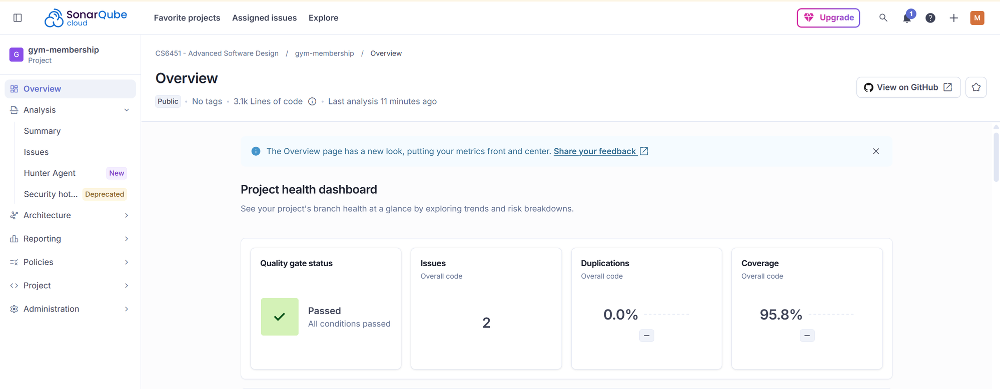
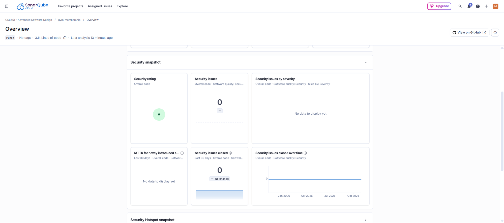
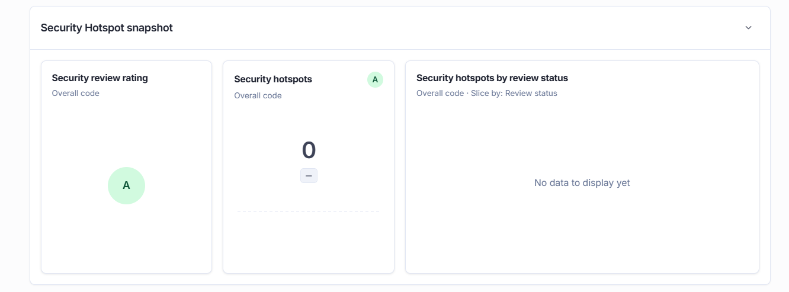
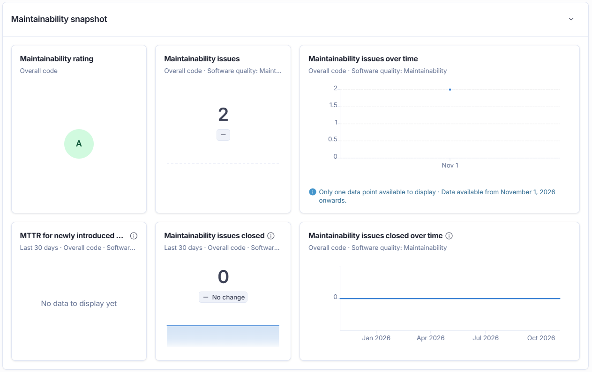
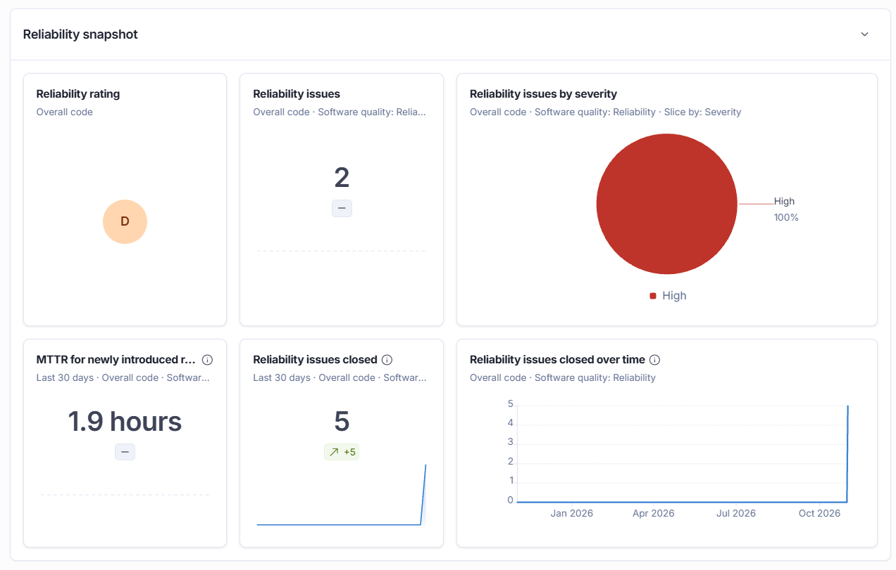

# Added Value {#added-value}

<!--
Owner: DineshReddy.
CI/CD that fails the build when a test fails, and the deploy to Railway. Metrics leading to refactoring: PMD and CK
before, the classes we refactored and why, and the numbers after. SonarQube Cloud on the whole codebase before and
after, with a dashboard screenshot. UI, ORM, security and login don't count.
Evidence: .github/workflows, the metrics comment on each PR, report/metrics (to be created).
-->

## CI/CD

CI (`.github/workflows/ci.yml`) runs three matrix lanes - unit, integration and end-to-end - each a plain `./mvnw verify` with no `continue-on-error`, so one failing test fails the whole run and blocks the merge (`main` is a protected branch). A separate `Metrics` job merges the three lanes' JaCoCo coverage, runs PMD and CK, and posts the numbers as a comment edited in place on every push to the pull request, so a reviewer sees them without downloading an artifact. Every action is pinned to a commit SHA, not a tag. A `Report` workflow (`.github/workflows/report.yml`) rebuilds the report PDF on every change under `report/` and fails if a section goes over the spec's page limit. On `main`, Railway builds `code/Dockerfile` and redeploys automatically, with `/actuator/health` as its health check.

Reviewing all three workflows end to end as Technical Lead found and fixed:

- `curl -sLo` for the JaCoCo and CK jars had no `-f` flag, so a broken Maven Central URL would silently write an HTML error page to the `.jar` path and fail several steps later with a cryptic `ZipException`, instead of a clear error at the real point of failure.
- None of `ci.yml`'s two jobs, `release.yml` or `report.yml` set `timeout-minutes`, so a hung test, or a release or report build stuck waiting on something, could burn CI minutes for up to GitHub's 6-hour default before being killed. All four jobs across the three workflows now bound their runtime.

## Metrics Leading to Refactoring

PMD (`code/pmd-ruleset.xml`) and CK (CBO, WMC, RFC, LOC) run on every PR; CI keeps every run's reports as a `metrics` artifact so the before numbers always exist, and a copy of each step below is also kept in `report/metrics/`. Combined, they pointed at the same two classes as the worst in the codebase: `BillingService`, which PMD flagged as an actual `GodClass`, and `MembershipService`, both with the highest WMC and RFC of any class.

| Class | Metric | Before | After | What changed |
| --- | --- | --- | --- | --- |
| `BillingService` | CBO / WMC / RFC / LOC | 25 / 54 / 76 / 192 | 22 / 44 / 64 / 171 | Extracted `account()` and its two private helpers into a new `BillingAccountFactory` - a simple factory for `BillingAccount`, the same way `PlanFactory` is one for `Plan`. `MemberRepository` was only used by that trio, so `BillingService` drops it entirely rather than just delegating to it |
| `BillingService` | PMD violations | 3: `GodClass`, `TooManyMethods`, `ExcessiveImports` | 1: `TooManyMethods` | `GodClass` is gone |
| `MembershipService` | CBO / WMC / RFC / LOC | 28 / 36 / 55 / 134 | 26 / 25 / 49 / 96 | Extracted `runDailyChecks()` and its private `recordUnpaidInvoices()` helper into a new `MembershipDailyChecksService` - a nightly batch sweep over every membership, a different responsibility from an operation on the one membership a request names. `ViewInvoicesUseCase` was only used by that pair |
| `MembershipService` | PMD violations | 5: `ExcessiveImports`, `CouplingBetweenObjects`, `TooManyMethods`, `UseLocaleWithCaseConversions` x2 | 1: `TooManyMethods` | Also fixed the two `UseLocaleWithCaseConversions` violations directly (`Locale.ROOT`) before extracting the method |

Table: PMD and CK before and after refactoring (`report/metrics/before-refactor/`, `after-refactor-1/`, `after-refactor-2/`)

Both new classes carry zero PMD violations. Neither extraction needed any Spring wiring changes: `MembershipChecksJob` and `MembershipController` already depended on the `RunDailyChecksUseCase` *interface*, not the concrete class, so Spring injects the new bean automatically. The full test suite (unit, integration, end-to-end, real Spring context boot) stayed green before and after each change.

## SonarQube Cloud

SonarQube Cloud now runs in CI's `metrics` job, authenticated with a `SONAR_TOKEN` secret, after the coverage/PMD gates. There is no true before/after pair for it the way PMD/CK have one: Sonar wasn't wired up until after both refactorings above were already merged, so a "before" snapshot would mean checking out an old commit by hand rather than showing what the pipeline actually measured at the time - not something to fake. What follows is the first real scan, plus what changed in the three days since.

| Metric | Value |
| --- | --- |
| Quality gate | Passed |
| Coverage | 95.8% |
| Duplication | 0.0% |
| Security rating | A (0 vulnerabilities) |
| Security review rating | A (0 hotspots) |
| Maintainability rating | A (0 code smells) |
| Reliability rating | D (2 issues) |

Security, Security Hotspots and Maintainability are all A, with nothing open to explain:

Reliability is the one rating not at A, and it is worth explaining rather than leaving as a number: SonarQube rates by the *worst* open issue's severity, not by count. The scan originally found 7 High-severity issues: 5 were `MembershipState` holding static references to its own 5 subclasses (rule `S2390`), real and now fixed by the `MembershipStateFactory` extraction above; the other 2 are `OffPeakPlan.java:22`'s `day != DayOfWeek.SATURDAY && day != DayOfWeek.SUNDAY` (rule `S8696`, "use `.equals()` not `==`"). That second pair is a false positive, left as `==` on purpose: `DayOfWeek` is an enum, so `!=` on its constants is JLS-guaranteed-safe and is the comparison Effective Java recommends - `java.time`'s "value-based class" Javadoc disclaimer is boilerplate copied onto its enums too, even though enums can't have the identity problem it warns about. Changing it to `.equals()` would read worse for a cosmetic rating change, so the rating stays D with those 2 issues open rather than being silently "fixed" for the wrong reason.

