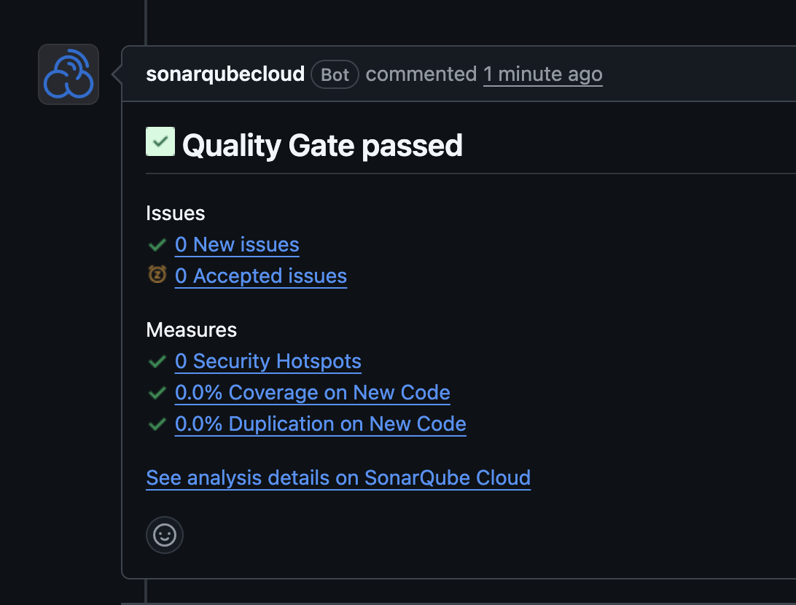

# Added Value {#added-value}

<!--
Owner: DineshReddy.
CI/CD that fails the build when a test fails, and the deploy to Railway. Metrics leading to refactoring: PMD and CK
before, the classes we refactored and why, and the numbers after. SonarQube Cloud on the whole codebase before and
after, with a dashboard screenshot. UI, ORM, security and login don't count.
Evidence: .github/workflows, the metrics comment on each PR, report/metrics (to be created).
-->

## CI/CD

Our CI (`.github/workflows/ci.yml`) runs three test lanes, unit, integration and end-to-end, each one just `./mvnw verify`. There's no `continue-on-error` anywhere, so one failing test blocks the whole merge, since `main` is a protected branch. A separate `Metrics` job merges the coverage from all three lanes, runs PMD and CK, and posts the numbers as a comment on the PR. On `main`, Railway builds `code/Dockerfile` and redeploys on its own.

Going through all three workflows as the DevOps lead, I found two real problems and fixed both:

- The `curl -sLo` call downloading the JaCoCo and CK jars didn't have `-f`, so an error page from Maven Central would have been saved as the `.jar` and failed several steps later.
- None of the jobs had `timeout-minutes` set, so a stuck build could have run for GitHub's default 6 hours.

## Metrics Leading to Refactoring

PMD and CK run on every PR, and I saved a copy of each stage in `report/metrics/`. Both tools agreed on the same two worst classes: `BillingService`, which PMD flagged as a `GodClass`, and `MembershipService`, which had the highest WMC and RFC.

| Class | Before | After | What changed |
| --- | --- | --- | --- |
| BillingService | CBO 25, WMC 54, RFC 76, LOC 192. PMD: GodClass, TooManyMethods, ExcessiveImports | CBO 22, WMC 44, RFC 64, LOC 171. PMD: TooManyMethods | Extracted `account()` and its two helpers into a new BillingAccountFactory, so GodClass is gone |
| MembershipService | CBO 28, WMC 36, RFC 55, LOC 134. PMD: ExcessiveImports, CouplingBetweenObjects, TooManyMethods, UseLocaleWithCaseConversions x2 | CBO 26, WMC 25, RFC 49, LOC 96. PMD: TooManyMethods | Extracted `runDailyChecks()` into a new MembershipDailyChecksService, a nightly batch over every membership, and fixed the two UseLocaleWithCaseConversions with `Locale.ROOT` |

Table: PMD and CK before and after refactoring (`report/metrics/`)

Both new classes come out with zero PMD violations, and the full test suite stayed green before and after each change. I left Booking out while it was still being built, and when I re-checked it on 2 Nov the Command-pattern work had already cut `BookingService`'s WMC from 40 to 30, so I didn't force a third refactor.

## SonarQube Cloud

SonarQube Cloud runs inside CI's `metrics` job. It was only wired in after both refactors were merged, so there isn't a real before/after pair like PMD/CK has. This is the scan from 3 Nov, once Booking was fully merged in.

| Metric | Value |
| --- | --- |
| Quality gate | Passed |
| Coverage | 96.3% |
| Duplication | 0.0% |
| Security rating | A (0 vulnerabilities) |
| Security review rating | A (0 hotspots) |
| Maintainability rating | A (0 issues) |
| Reliability rating | A (0 bugs) |

{width=60%}

Reliability took a bit more work to get to A. The scan first found 7 High severity issues. 5 of them were `MembershipState` holding static references to its own subclasses (rule `S2390`), which was real and is fixed by the `MembershipStateFactory` extraction. The other 2 were `day != DayOfWeek.SATURDAY` in `OffPeakPlan` (rule `S8696`, which wants `.equals()`). `DayOfWeek` is an enum, so `!=` is safe there, and I resolved both as `False Positive` in SonarCloud instead of changing the code.
