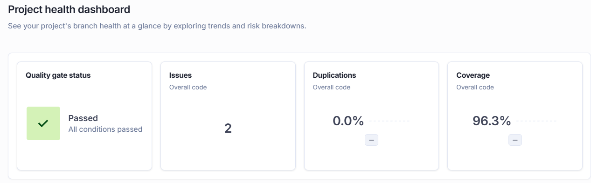
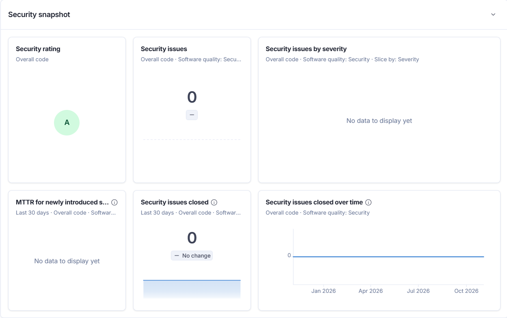
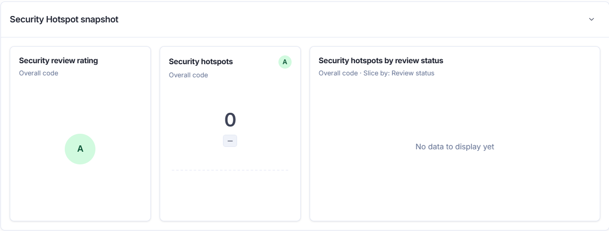
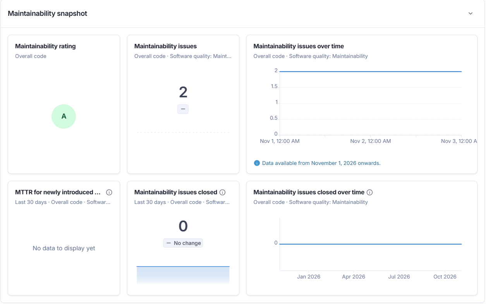
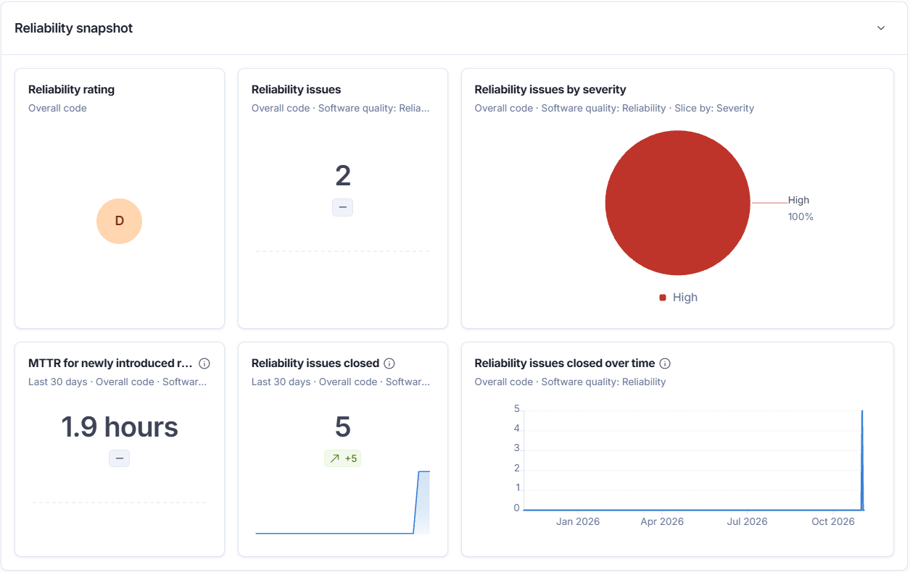

# Added Value {#added-value}

<!--
Owner: DineshReddy.
CI/CD that fails the build when a test fails, and the deploy to Railway. Metrics leading to refactoring: PMD and CK
before, the classes we refactored and why, and the numbers after. SonarQube Cloud on the whole codebase before and
after, with a dashboard screenshot. UI, ORM, security and login don't count.
Evidence: .github/workflows, the metrics comment on each PR, report/metrics (to be created).
-->

## CI/CD

Our CI (`.github/workflows/ci.yml`) runs three test lanes, unit, integration and end-to-end, each one just `./mvnw verify`. There's no `continue-on-error` anywhere, so one failing test blocks the whole merge, since `main` is a protected branch. A separate `Metrics` job merges the coverage from all three lanes, runs PMD and CK, and posts the numbers as a comment on the PR, the same comment edited each push, so nobody has to download an artifact just to see them. Every action is pinned to a commit SHA instead of a tag. There's also a `Report` workflow (`.github/workflows/report.yml`) that rebuilds the report PDF whenever anything under `report/` changes, and fails if a section goes over its page limit. On `main`, Railway builds `code/Dockerfile` and redeploys on its own, using `/actuator/health` as the health check.

Going through all three workflows properly as the DevOps lead, I found two real problems and fixed both:

- The `curl -sLo` call downloading the JaCoCo and CK jars didn't have `-f`. If Maven Central ever returned an error page instead of the jar, curl would happily save that HTML as the `.jar` file, and the real failure wouldn't show up until several steps later as a confusing `ZipException`.
- None of the jobs anywhere, `ci.yml`'s two jobs, `release.yml`, `report.yml`, had `timeout-minutes` set. A stuck test or a hanging build could have run for up to GitHub's default 6 hours before anyone noticed. All four jobs now have a sensible timeout.

## Metrics Leading to Refactoring

PMD (`code/pmd-ruleset.xml`) and CK (CBO, WMC, RFC, LOC) run on every PR. CI keeps the reports from each run as a `metrics` artifact, so there's always a real before snapshot, and I also saved a copy of each stage in `report/metrics/`. Both tools agreed on the same two worst classes in the codebase: `BillingService`, which PMD actually flagged as a `GodClass`, and `MembershipService`, which had the highest WMC and RFC of anything else.

| Class | Metric | Before | After | What changed |
| --- | --- | --- | --- | --- |
| `BillingService` | CBO / WMC / RFC / LOC | 25 / 54 / 76 / 192 | 22 / 44 / 64 / 171 | Extracted `account()` and its two private helpers into a new `BillingAccountFactory` - a simple factory for `BillingAccount`, the same way `PlanFactory` is one for `Plan`. `MemberRepository` was only used by that trio, so `BillingService` drops it entirely rather than just delegating to it |
| `BillingService` | PMD violations | 3: `GodClass`, `TooManyMethods`, `ExcessiveImports` | 1: `TooManyMethods` | `GodClass` is gone |
| `MembershipService` | CBO / WMC / RFC / LOC | 28 / 36 / 55 / 134 | 26 / 25 / 49 / 96 | Extracted `runDailyChecks()` and its private `recordUnpaidInvoices()` helper into a new `MembershipDailyChecksService` - a nightly batch sweep over every membership, a different responsibility from an operation on the one membership a request names. `ViewInvoicesUseCase` was only used by that pair |
| `MembershipService` | PMD violations | 5: `ExcessiveImports`, `CouplingBetweenObjects`, `TooManyMethods`, `UseLocaleWithCaseConversions` x2 | 1: `TooManyMethods` | Also fixed the two `UseLocaleWithCaseConversions` violations directly (`Locale.ROOT`) before extracting the method |

Table: PMD and CK before and after refactoring (`report/metrics/before-refactor/`, `after-refactor-1/`, `after-refactor-2/`)

Both new classes come out with zero PMD violations. I didn't have to touch any Spring wiring either time, because `MembershipChecksJob` and `MembershipController` were already depending on the `RunDailyChecksUseCase` interface, not the concrete class, so Spring just picked up the new bean on its own. I ran the full test suite, unit, integration, end-to-end, with a real Spring context boot, before and after each change, and it stayed green both times.

Booking (Bharat's feature) was still being built when I picked these two classes, so I left it out on purpose and went back to check it once it settled. By 2 Nov, `BookingService`'s own WMC had already dropped from 40 to 30 on its own, because the Command-pattern work (`BookingCommandService`, `AttendanceService`, `ScheduleService`, `BookingQueries`) pulled a lot out of it already. PMD doesn't flag it with `GodClass` or `TooManyMethods` anymore either. I re-ran PMD and CK against the finished codebase (raw output's in `report/metrics/`) and found zero `GodClass` or `CouplingBetweenObjects` violations anywhere, the two refactors above already got rid of every real one, and nothing new has shown up since, so I didn't force a third refactor just to have one.

## SonarQube Cloud

SonarQube Cloud now runs inside CI's `metrics` job, after the coverage and PMD gates, using a `SONAR_TOKEN` secret. There isn't a real before/after pair for this one the way there is for PMD/CK, Sonar wasn't even wired in until after both refactors above were already merged. A "before" snapshot would mean checking out an old commit by hand just to fake a number, which isn't something I wanted to do. So what's below is that first real scan, refreshed again on 3 Nov once Booking was fully merged in.

| Metric | Value |
| --- | --- |
| Quality gate | Passed |
| Coverage | 96.3% |
| Duplication | 0.0% |
| Security rating | A (0 vulnerabilities) |
| Security review rating | A (0 hotspots) |
| Maintainability rating | A (0 issues) |
| Reliability rating | A (0 bugs) |

{width=100%}

Security, Security Hotspots and Maintainability all came back A straight away:

{width=100%}

{width=100%}

{width=100%}

Reliability took a bit more work to get to A, and it's worth explaining how rather than just showing the number. SonarQube grades by the worst open issue, not by how many there are. The scan first found 7 High severity issues. 5 of them were `MembershipState` holding static references to its own 5 subclasses (rule `S2390`), that one's real, and it's fixed by the `MembershipStateFactory` extraction above. The other 2 were in `OffPeakPlan.java:22`, on the line `day != DayOfWeek.SATURDAY && day != DayOfWeek.SUNDAY` (rule `S8696`, which wants `.equals()` instead of `==`). I checked that one properly before touching anything: `DayOfWeek` is an enum, so `!=` on enum constants is guaranteed safe by the language itself, and it's actually what Effective Java recommends. The "value-based class" warning in `java.time`'s Javadoc gets copy-pasted onto its enums too, even though enums don't have the identity problem that warning is about. Changing the code to `.equals()` would have made it read worse for a rating that's cosmetic anyway, so instead of touching the code I resolved both as `False Positive` directly in SonarCloud, which is what that status is for once you've actually verified it isn't a bug. Reliability moved to A once that landed.

{width=100%}
