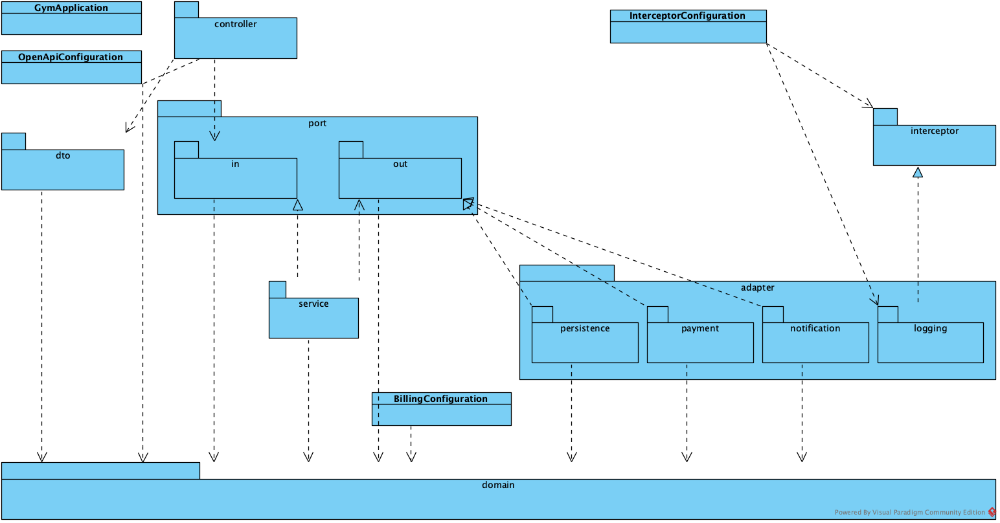
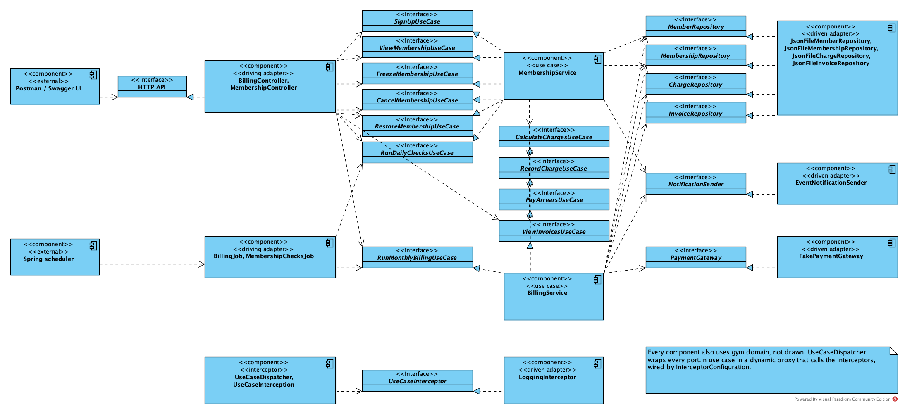
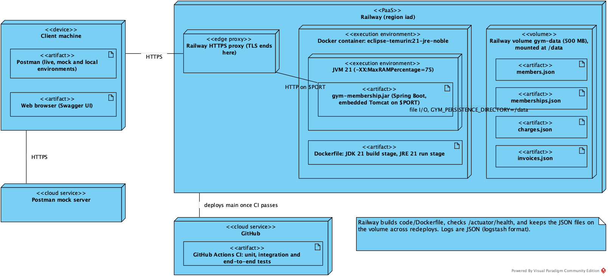

# Recovered Blueprints {#recovered-blueprints}

<!--
Owner: Chirag.
Recovered from the code in Visual Paradigm (not hand-written PlantUML), with the choice of workbench justified. The
design-time package diagram compared with the one in the Architecture section, with the differences explained.
Component and deployment diagrams. A note under each saying what it shows.
Evidence: report/blueprints/ (the Visual Paradigm project, the exported diagrams, and how they were built).
-->

## Workbench

The specification asked us to use a UML workbench, choosing from the community edition tools. On doing some research Visual Paradigm came out on top, offering a Community Edition as well which was completely free. It supported the three diagrams we wanted to make as well.

None of us had any experience with the software, so we did a little research and found we could use the `Instant Reverse` feature on it so the model behind the diagrams comes from the code itself.

One hacky workaround we did was the feature was not available in the CE, so we took a 30-day trial of the Enterprise version to use it, and then used the CE version to export it and avoid the evaluation watermark.

| Step | What came out |
| --- | --- |
| Instant Reverse on `code/src/main/java` | 66 of 85 types: all 19 `record` types silently dropped |
| Instant Reverse on `code/target/classes` | All 85 types and 14 packages |
| Package edges from the `import` lines | 19 edges (Instant Reverse skips imports) |
| Drawn by an Open API plugin (GenAI #57) | The three diagrams, in `report/blueprints/gym-membership.vpp` |
| Exported from Community Edition 18.1 | PNGs with a small Community Edition mark |

Table: How the blueprints were recovered (on 27 Oct, before the Member feature in #58)

When using source code for reverse engineering, we found 19 of the 85 types (every DTO and the core domain classes) were missing from the reversed model. The issue was our source code using the `record` feature from Java. Example -

a domain record, Charge (gym/domain/Charge.java, trimmed):
```java
public record Charge(String id, String membershipId, ChargeType type,
                     Money amount, LocalDate date, String invoiceId) {
    public Charge {
        Objects.requireNonNull(id, "id");
        ...
    }
}
```

It's a common way of defining data classes in Java since Java 16, a class whose only job is to hold some data and never change it. Visual Paradigm did not support this new syntax. So we compiled the code and used the `code/target/classes` folder, which holds the compiled bytecode instead of source code.

## Design-Time Package Diagram

{width=100%}

This is the real package diagram as interpreted by the Visual Paradigm software using our codebase, with the arrows taken from the imports. It mostly matches the design we created. Just a few differences exist that you can see below:

| Recovered, not in §5 | Why |
| --- | --- |
| `dto` → `domain` (16 imports) | DTOs are built from domain objects |
| `controller` → `domain` (2) | ErrorHandler maps domain exceptions to HTTP errors |
| `adapter.persistence` → `domain` (4) | The JSON adapter stores domain objects (§5's liability) |
| Root package `gym` | Composition root: wires the Strategy and the Interceptor |
| No stereotypes | Intent isn't in the code |
| No booking or member management | Booking isn't built yet; member management and check-in came after the recovery (#58) |

Table: Design-time against recovered package diagram

I believe the biggest issue to fix would be the `adapter.persistence` → `domain` drift. Currently the saved JSON files being directly tied to the domain objects can cause storage-level errors if in future we decide to modify the domain logic. For example, if we add a new field, the existing JSON files would just lead to errors when loading existing data, instead of cleanly handling it through optional logic.

::: landscape
## Component Diagram

{width=100%}

Here the diagram shows components as per the classes we needed in our code. BillingService is in the centre acting as the core of the Hexagonal architecture we intended, with all six driven ports around it. UseCaseDispatcher wraps all the use case (`port.in`) ports, as the Interceptor pattern intended, and then calls the LoggingInterceptor.
:::

## Deployment Diagram

{width=100%}

Although actually hosting the app was not required as per the specifications of the project, we had a fun time exploring different services and ultimately landing on Railway as a simple deployment infrastructure provider. We define the service via a Dockerfile that Railway can deploy directly, and a Railway volume instead of a database for persisting our JSON files.
